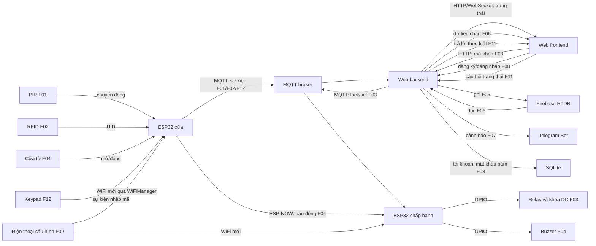

# ĐỀ XUẤT 01 — SMART HOME SECURITY SYSTEM

**Đề tài:** Hệ thống an ninh nhà thông minh  
**Trường, khoa, mã nhóm, họ tên và MSSV:** Nhóm bổ sung.  
**Thành viên tạm:** A, B, C.

Bản này theo [Yêu cầu thuyết minh dự án](<docs/CQ_YÊU CẦU THUYẾT MINH DỰ ÁN.pdf>) và [Quy định đồ án cuối kỳ](<docs/CQ_QUY ĐỊNH ĐỒ ÁN CUỐI KỲ.pdf>). Khi nộp chính thức, nhóm xuất PDF với trang bìa, font Times New Roman 13, giãn dòng 1,15, canh đều, ảnh rõ và tên file đúng mẫu. Quy định chỉ cho điều chỉnh tối đa một chức năng sau khi chốt bản thuyết minh.

## 1. Giới thiệu

### 1.1. Tổng quan

Mô hình cửa phòng dùng PIR phát hiện chuyển động, RFID ghi nhận lần quét thẻ, khóa điện DC điều khiển từ website. Hai ESP32 gồm node ở cửa và node chấp hành/gateway. Các luồng căn bản truyền qua MQTT đến web backend rồi frontend. Khi cửa bị mở trái phép, công tắc cửa từ gửi trực tiếp qua ESP-NOW để kích còi tại chỗ dù mất Internet. Keypad báo lần nhập mã lên web. Firebase RTDB lưu lịch sử; website tự xây hiển thị biểu đồ và chatbot truy vấn trạng thái; Telegram gửi cảnh báo. Người dùng đăng ký/đăng nhập qua backend có tài khoản trong SQLite; WiFiManager cho phép đổi mạng WiFi tại thiết bị thật. Giá trị thực tế là theo dõi lối vào, truy vết sự kiện và có cảnh báo cục bộ.

### 1.2. Danh sách chức năng

Theo quy định, ba chức năng căn bản do ba người phụ trách, từng thiết bị input/output dùng để tính điểm khác nhau. Một người chịu trách nhiệm chính cho từng ID.

| ID | Loại, mục quy định | Thiết bị/dịch vụ | Luồng xử lý dự kiến | Người phụ trách |
|---|---|---|---|---|
| F01 | Căn bản: input → web | PIR HC-SR501 | PIR → ESP32 cửa → MQTT → backend → frontend: hiển thị chuyển động và thời điểm. | A |
| F02 | Căn bản: input → web | RFID RC522 | Thẻ → ESP32 cửa → MQTT → backend → frontend: hiển thị UID và kết quả đối chiếu. | B |
| F03 | Căn bản: web → output | Khóa điện DC qua relay | Frontend → backend kiểm tra lệnh → MQTT → ESP32 chấp hành → relay → khóa mở có giới hạn thời gian. | C |
| F04 | Nâng cao #1: input → output, 1,5 điểm | Công tắc cửa từ → buzzer | Công tắc từ → ESP32 cửa → ESP-NOW → ESP32 chấp hành → buzzer khi đang canh gác. | C |
| F05 | Nâng cao #4: lưu theo thời gian, 1,5 điểm | Firebase RTDB | Backend lưu lịch sử sự kiện PIR, RFID và lệnh khóa kèm thời gian lên cloud. | A |
| F06 | Nâng cao #5: chart, 1,5 điểm | Firebase RTDB | Backend đọc cloud → frontend vẽ biểu đồ cảnh báo theo ngày và bảng lịch sử. | B |
| F07 | Nâng cao #6: thông báo nhanh, 1 điểm | Telegram Bot | Backend gửi cảnh báo xâm nhập, có chặn gửi lặp. | C |
| F08 | Nâng cao #9: bảo mật, 1,5 điểm | SQLite | Đăng ký/đăng nhập qua backend; tài khoản và mật khẩu băm lưu trong SQLite; phiên đăng nhập bảo vệ các trang quản lý và lệnh mở khóa. | A |
| F09 | Nâng cao #12: cấu hình WiFi, 1 điểm | WiFiManager | Trên hai ESP32 thật, khi chưa có mạng đã lưu hoặc nhấn nút cấu hình, mở cổng cấu hình để nhập WiFi mới; kết nối lại MQTT và kiểm tra kênh ESP-NOW. | A |
| F10 | Nâng cao #10: tự xây website, 2 điểm | Website tự xây | B chịu trách nhiệm triển khai website quản lý (backend/frontend, trạng thái, lịch sử, biểu đồ, giao diện lệnh), tích hợp API/MQTT do các thành viên khác cung cấp; không dùng Node-RED. | B |
| F11 | Nâng cao #8: chatbot điều kiện, 0,5 điểm | Chatbot tự xây | Ô chat trên website nhận câu hỏi cố định về trạng thái cửa/cảnh báo gần nhất; backend tra dữ liệu rồi trả lời theo luật điều kiện. | B |
| F12 | Nâng cao #2: input → web, 1,5 điểm | Keypad 3×4 | Keypad → ESP32 cửa → MQTT → backend → frontend: hiện sự kiện nhập mã (không hiển thị mã thô). | C |

**Kiểm tra thiết bị:** F01 dùng PIR; F02 dùng RFID; F03 dùng khóa điện; F04 dùng riêng công tắc cửa từ và buzzer; F12 dùng keypad. Sáu thiết bị input/output này đôi một khác nhau và mỗi ID nâng cao có đúng một người phụ trách. ESP32 là board trung gian bắt buộc của nhiều luồng, không được tính như một cảm biến hoặc cơ cấu chấp hành riêng. F05/F06 đọc và lưu dữ liệu đã phát sinh từ hệ thống, không đăng ký thêm thiết bị input/output. Nếu giảng viên hiểu “thiết bị” bao gồm cả việc tái sử dụng dữ liệu của cảm biến trong chức năng cloud/biểu đồ, cần xác nhận cách chấm trước khi nộp. **Phương án này là sản phẩm thật**; quy tắc giả lập chỉ áp dụng nếu nhóm chuyển sang giả lập, khi đó phải kiểm lại giới hạn tối đa một thiết bị thay thế. OLED từ README ban đầu để dành cho phiên bản sau. F09 chỉ áp dụng cho sản phẩm thật; F11 dùng luật điều kiện.

## 2. Thiết kế

### 2.1. Bố trí bên ngoài và bên trong

Hộp cửa có cửa sổ PIR (F01), vùng quét RFID (F02), keypad dán mặt trước (F12) và công tắc từ gắn mép cửa (F04). ESP32 cửa nằm trong hộp, có lỗ USB để nạp mã và dùng nút BOOT có sẵn để gọi chế độ cấu hình WiFi (F09). Hộp chấp hành chứa ESP32 thứ hai, relay (F03), buzzer hướng ra lỗ âm (F04); khóa DC gắn trên mô hình cửa. Dây tải khóa và dây tín hiệu đi riêng; nguồn khóa chọn theo điện áp/dòng định mức của mẫu thực tế.

```text
Mặt trước: [PIR F01] [RFID F02] [Keypad F12] | CỬA + công tắc từ F04 |
Trong hộp cửa: [ESP32 cửa] [đầu nối PIR/RFID/cửa từ/keypad] [BOOT F09]
Trong hộp chấp hành: [ESP32 gateway] [relay F03] [buzzer F04]
Ngoài hộp: [khóa điện DC F03] [nguồn DC]
```

Đây là phác thảo bố trí. Trước khi nộp PDF phải dựng ảnh 3D hai góc nhìn ngoài/trong và ghi ID cạnh linh kiện theo mẫu.

### 2.2. Wireframe website

```text
┌─────────────────────────────────────────────────────────────┐
│ ĐĂNG KÝ / ĐĂNG NHẬP F08; TRẠNG THÁI KẾT NỐI MQTT            │
├─────────────────────────────┬───────────────────────────────┤
│ Chuyển động F01             │ Lần quét RFID F02             │
│ Cửa/còi F04; Keypad F12     │ Nút MỞ KHÓA, tự đóng F03      │
├─────────────────────────────┴───────────────────────────────┤
│ Biểu đồ F06 | Lịch sử F05/F06 | Ô chat trạng thái F11       │
└─────────────────────────────────────────────────────────────┘
```

### 2.3. Sơ đồ truyền và nhận dữ liệu



Khi nối WiFi và ESP-NOW đồng thời phải thử kênh WiFi của router; [Espressif](https://docs.espressif.com/projects/arduino-esp32/en/latest/api/espnow.html) yêu cầu các node ESP-NOW dùng cùng kênh. [WiFiManager](https://github.com/tzapu/WiFiManager) hỗ trợ cổng cấu hình cho ESP32, nhưng đổi WiFi có thể đổi kênh và cần thử lại F04. Lệnh mở khóa từ web phụ thuộc Internet, còn báo động F04 chạy nội bộ. [Home Security System](https://ocw.cs.pub.ro/courses/iothings/proiecte/2021/homesecurity) là dự án tham khảo cách bố trí ESP32, RFID và dashboard; nhóm tự thiết kế luồng MQTT/ESP-NOW.

### 2.4. Dự án tương tự và phần có thể tham khảo

| Nguồn | Phần hữu ích cho đề xuất | Điều chỉnh khi áp dụng |
| --- | --- | --- |
| [Home Security System — CS Open CourseWare](https://ocw.cs.pub.ro/courses/iothings/proiecte/2021/homesecurity) | ESP32 kết hợp RFID, keypad và giao diện theo dõi; có mô tả đấu nối và mã minh họa. | Chỉ tham khảo bố trí và đọc thẻ/phím; giữ F02 và F12 là hai luồng input riêng, không dùng lại một thiết bị cho yêu cầu khác. |
| [Modular Home Security — GitHub](https://github.com/SimpleMindedMoron/modular-home-security) | Có mã nguồn node truy cập, giao diện web và bảng topic MQTT cho lệnh khóa, trạng thái, nhật ký. | Đổi đường dữ liệu thành ESP32 ↔ MQTT ↔ backend ↔ frontend đúng yêu cầu môn học; không đưa camera/AI vào phạm vi bốn tuần. |
| [ESP-NOW MQTT gateway — GitHub](https://github.com/fluidwire/esp32-espnow-mqtt-gateway) | Minh họa ESP32 dùng đồng thời WiFi/MQTT và ESP-NOW, đưa gói nhận vào hàng đợi trước khi publish. | F04 chỉ cần gửi công tắc từ đến node còi qua ESP-NOW; thử chung kênh WiFi và thử cảnh báo khi mất Internet. |

Các nguồn trên là mẫu kiến trúc và mã tham khảo, chưa chứng minh toàn bộ tổ hợp F01–F12 hoạt động cùng nhau; nhóm cần tự tích hợp và kiểm thử trên phần cứng thật.

## 3. Triển khai

### 3.1. Danh sách linh kiện và dự toán

Giá VND tra ngày **28/10/2026**. Trang sản phẩm liên kết có ảnh linh kiện; khi xuất PDF cần chèn ảnh vào bảng hoặc phụ lục. Giá trên Shopee có thể đổi theo biến thể, voucher và thời điểm đặt hàng; số trong bảng chỉ là giá tham khảo đã thấy. Khoản vật tư mô hình ngoài dây nối chưa được định giá.

| STT | Linh kiện | SL | Đơn giá | Thành tiền | Nguồn giá / tình trạng | ID |
|---|---|---:|---:|---:|---|---|
| 1 | ESP32 DevKit V1 | 2 | 140.000 | 280.000 | [Linh Kiện Việt Nam](https://linhkienvietnam.vn/module-node-mcu-32s-esp32-devkitc-dung-module-esp-wroom-32) | F01–F04 |
| 2 | PIR HC-SR501 | 1 | 27.000 | 27.000 | [Hshop](https://hshop.vn/cam-bien-chuyen-dong-pir-5v-2) | F01 |
| 3 | RFID RC522 | 1 | 36.000 | 36.000 | [Hshop](https://hshop.vn/mach-rfid-rc522-nfc-13-56mhz) | F02 |
| 4 | Móc khóa RFID IC M1 13,56 MHz | 2 | 11.000 | 22.000 | [Shopee](https://shopee.vn/Th%E1%BA%BB-t%E1%BB%AB-RFID-IC-M1-13.56Mhz-m%C3%A0u-xanh-Lo%E1%BA%A1i-m%C3%B3c-kh%C3%B3a-i.119714962.22369848935) | F02 |
| 5 | Công tắc cửa từ MC-38 | 1 | 12.000 | 12.000 | [Shopee](https://shopee.vn/C%E1%BA%A3m-bi%E1%BA%BFn-c%E1%BB%ADa-MC-38-%28t%E1%BB%AB-tr%C6%B0%E1%BB%9Dng%29-TH334-i.310609561.3173442342), lấy đầu trên khoảng giá | F04 |
| 6 | Relay 1 kênh 5V | 1 | 20.000 | 20.000 | [HTPro](https://www.htpro.vn/Module-relay/module-relay-1-kenh-5v.html) | F03 |
| 7 | Khóa chốt điện từ LY-03 12V | 1 | 162.000 | 162.000 | [Shopee](https://shopee.vn/Kh%C3%B3a-Ch%E1%BB%91t-%C4%90i%E1%BB%87n-T%E1%BB%AB-LY-03---LY-01---Kh%C3%B3a-Ch%E1%BB%91t-%C4%90i%E1%BB%87n-T%E1%BB%AB-12V---24V-%E2%80%93-Solenoid-Lock-mini-cho-t%E1%BB%A7--c%E1%BB%ADa-th%C3%B4ng-minh-i.1911551836.58065677851), giá từ; kiểm tra đúng biến thể 12V | F03 |
| 8 | Buzzer chủ động 5V | 1 | 13.999 | 13.999 | [Shopee](https://shopee.vn/C%C3%B2i-Buzz-ch%E1%BB%A7-%C4%91%E1%BB%99ng-5V-Buzzer-5V-C%C3%B2i-ch%C3%ADp-5V-C%C3%B2i-Xung-5V-i.724892587.29404044258) | F04 |
| 9 | Adapter 5V 2A cho mỗi ESP32 (2 cái); adapter 12V 2A cho khóa (1 cái) | 1 bộ | 98.000 | 98.000 | [5V 2A](https://linhkienvietnam.vn/nguon-adapter-5v-2a-5v2a-kho-b-ka9h14) 2×30.000đ + [12V 2A](https://linhkienvietnam.vn/nguon-adapter-12v-2a-12v2a-kho-b-ka9h3) 38.000đ | F01–F04 |
| 10 | Hộp nhựa ABS 100×68×50 mm | 2 | 35.000 | 70.000 | [Shopee](https://shopee.vn/H%E1%BB%99p-nh%E1%BB%B1a-ABS-h%E1%BB%99p-nh%E1%BB%B1a-%C4%91%E1%BB%B1ng-m%E1%BA%A1ch-%C4%91i%E1%BB%87n-t%E1%BB%AD-tr%E1%BA%AFng-100x68x50mm-i.1192979059.24371671279); đo lại khi lắp | F01–F04 |
| 11 | Bộ dây nối breadboard 40 sợi | 1 bộ | 30.000 | 30.000 | [Hshop](https://hshop.vn/day-cam-breadboard-connector); vật tư mô hình khác chưa tính | F01–F04 |
| 12 | Bàn phím ma trận 3×4 | 1 | 15.000 | 15.000 | [Linh Kiện 024](https://linhkien024.vn/ban-phim-ma-tran-3x4) | F12 |
| | **Tổng tham khảo** | | | **785.999** | Chưa gồm vận chuyển, phụ kiện lắp ráp và dịch vụ | |

Chọn khóa và nguồn đồng bộ điện áp; relay chỉ đóng cắt nguồn khóa, không cấp tải từ GPIO ESP32. Kiểm tra giá và hạn mức Firebase/Telegram khi chốt ngân sách.

### 3.2. Kế hoạch thực hiện

**Tuần 1–4 tính từ tuần nhóm chốt đề xuất.** Đây là lịch rút gọn cho 12 ID chức năng; ba người triển khai song song và cần đặt mua linh kiện ngay đầu Tuần 1. Hai PDF không nêu ngày học kỳ cụ thể, nên nhóm điền ngày thực tế trước khi nộp.

| Tuần | ID | Đầu ra kiểm chứng | Người phụ trách chính |
|---|---|---|---|
| 1 | F01, F05 | PIR → MQTT → backend; tạo cấu trúc Firebase và hợp đồng dữ liệu | A |
| 1 | F02, F10 | RFID → MQTT; dựng website backend/frontend, trang trạng thái | B |
| 1–2 | F03 | Web → MQTT → relay/khóa; giới hạn thời gian mở | C |
| 2 | F08 | Đăng ký, đăng nhập, mật khẩu băm trong SQLite; bảo vệ lệnh khóa | A |
| 2 | F04 | Công tắc từ → ESP-NOW → còi; thử mất Internet | C |
| 2–3 | F09 | WiFiManager trên hai ESP32 thật; đổi mạng và thử lại MQTT/ESP-NOW | A |
| 2–3 | F06, F10 | Đọc Firebase, hoàn thiện chart và lịch sử trên website tự xây | B |
| 3 | F05 | Hoàn chỉnh lưu sự kiện theo thời gian và truy xuất | A |
| 3 | F11 | Chatbot luật điều kiện truy vấn trạng thái, kiểm thử câu hỏi hợp lệ | B |
| 3 | F12 | Keypad → MQTT → web, không lộ mã thô | C |
| 3–4 | F07 | Telegram cảnh báo, chặn gửi lặp | C |
| 4 | F01–F12 | Tích hợp, thử mất mạng/đổi WiFi, đóng hộp, dựng 3D, xuất PDF | A điều phối; B/C cùng kiểm thử |

## 4. Tổng kết và phân chia công việc

Theo mục **C.1 — Yêu cầu căn bản** của [Quy định đồ án cuối kỳ](<docs/CQ_QUY ĐỊNH ĐỒ ÁN CUỐI KỲ.pdf>), mỗi sinh viên phụ trách **một trong hai luồng**: thiết bị input → ESP → MQTT → web backend → web frontend, hoặc web frontend → web backend → MQTT → ESP → thiết bị output. Thiết bị input/output giữa các luồng phải đôi một khác nhau. Sinh viên hiểu và giải thích được toàn bộ luồng liên quan có thể đạt **4 điểm chức năng căn bản**; mã của các thành viên tích hợp chung một project được **1 điểm làm việc nhóm**. Vì vậy, cột “Điểm căn bản” dưới đây ghi **5,0 = 4,0 chức năng + 1,0 làm việc nhóm**, với điều kiện cả hai phần đạt yêu cầu.

Theo mục **C.2 — Yêu cầu nâng cao**, mức tối đa là **4 điểm/người**. Điểm nâng cao trong bảng là tổng các chức năng được phân công: A = F05 (1,5) + F08 (1,5) + F09 (1,0); B = F06 (1,5) + F10 (2,0) + F11 (0,5); C = F04 (1,5) + F07 (1,0) + F12 (1,5). Mỗi yêu cầu do một người phụ trách; điểm là dự kiến, phụ thuộc sản phẩm và vấn đáp. Điểm báo cáo cuối kỳ (tối đa 1) và mức cộng xét cho sản phẩm thật (tối đa 1) chưa đưa vào bảng.

| Thành viên | ID phụ trách | Điểm căn bản (gồm nhóm) | Điểm nâng cao | Tổng tạm tính, chưa gồm báo cáo |
|---|---|---:|---:|---:|
| A | F01, F05, F08, F09 | 5,0 | 4,0 | 9,0 |
| B | F02, F06, F10, F11 | 5,0 | 4,0 | 9,0 |
| C | F03, F04, F07, F12 | 5,0 | 4,0 | 9,0 |

Cả ba cùng tích hợp mã trong một project và chuẩn bị giải thích các luồng liên quan khi vấn đáp.
