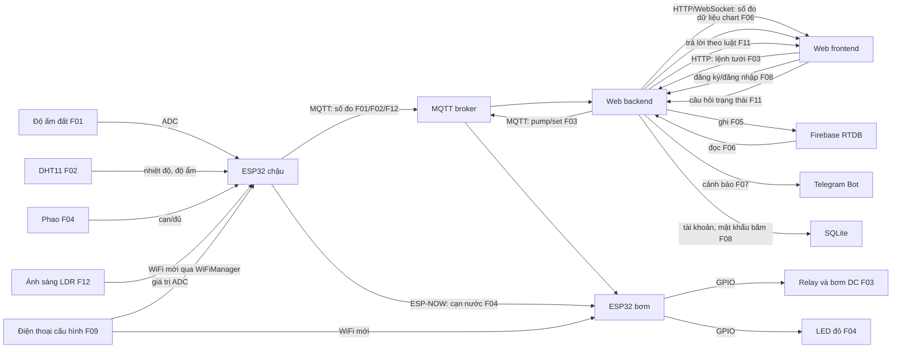

# ĐỀ XUẤT 02 — SMART GARDEN IRRIGATION SYSTEM

**Đề tài:** Hệ thống giám sát và tưới vườn thông minh  
**Trường, khoa, mã nhóm, họ tên và MSSV:** Nhóm bổ sung.  
**Thành viên tạm:** A, B, C.

Bản này theo [Yêu cầu thuyết minh dự án](<docs/CQ_YÊU CẦU THUYẾT MINH DỰ ÁN.pdf>) và [Quy định đồ án cuối kỳ](<docs/CQ_QUY ĐỊNH ĐỒ ÁN CUỐI KỲ.pdf>). Khi nộp chính thức, nhóm xuất PDF với trang bìa, font Times New Roman 13, giãn dòng 1,15, canh đều, ảnh rõ và tên file đúng mẫu. Quy định chỉ cho điều chỉnh tối đa một chức năng sau khi chốt bản thuyết minh.

## 1. Giới thiệu

### 1.1. Tổng quan

Mô hình chậu cây đo độ ẩm đất và nhiệt độ/độ ẩm không khí, gửi lên website. Người dùng ra lệnh tưới qua website để chạy bơm mini có giới hạn thời gian. Khi bồn chứa cạn, phao nước gửi tín hiệu qua ESP-NOW để bật LED cảnh báo tại chỗ dù mất Internet; người dùng cần bổ sung nước trước khi tưới tiếp. Cảm biến LDR gửi độ sáng lên web. Hai ESP32 gồm node đo ở chậu và node bơm/gateway. Các luồng căn bản dùng MQTT qua web backend. Firebase RTDB lưu dữ liệu theo thời gian; website tự xây vẽ biểu đồ, có chatbot hỏi trạng thái; Telegram cảnh báo đất khô hoặc cảm biến mất dữ liệu. Người dùng đăng ký/đăng nhập qua backend lưu tài khoản trong SQLite; WiFiManager cho phép đổi mạng tại thiết bị thật. Giá trị thực tế là theo dõi cây, biết lịch sử tưới và được cảnh báo khi bồn cạn.

### 1.2. Danh sách chức năng

Theo quy định, ba chức năng căn bản do ba người phụ trách, từng thiết bị input/output dùng để tính điểm khác nhau. Một người chịu trách nhiệm chính cho từng ID.

| ID | Loại, mục quy định | Thiết bị/dịch vụ | Luồng xử lý dự kiến | Người phụ trách |
|---|---|---|---|---|
| F01 | Căn bản: input → web | Cảm biến độ ẩm đất điện dung | Cảm biến → ESP32 chậu → MQTT → backend → frontend: độ ẩm đất và thời điểm đo. | A |
| F02 | Căn bản: input → web | DHT11 | DHT11 → ESP32 chậu → MQTT → backend → frontend: nhiệt độ và độ ẩm không khí. | B |
| F03 | Căn bản: web → output | Bơm nước mini DC qua relay | Frontend → backend → MQTT → ESP32 bơm → relay → bơm chạy tối đa thời gian đặt rồi tự tắt; luồng này không đọc phao F04. | C |
| F04 | Nâng cao #1: input → output, 1,5 điểm | Phao mức nước → LED | Phao trong bồn → ESP32 chậu → ESP-NOW → ESP32 bơm → LED đỏ khi bồn cạn. | C |
| F05 | Nâng cao #4: lưu theo thời gian, 1,5 điểm | Firebase RTDB | Backend lưu độ ẩm đất, khí hậu và sự kiện tưới có thời gian lên cloud. | A |
| F06 | Nâng cao #5: chart, 1,5 điểm | Firebase RTDB | Backend đọc cloud → frontend vẽ biểu đồ độ ẩm đất và lịch sử tưới. | B |
| F07 | Nâng cao #6: thông báo nhanh, 1 điểm | Telegram Bot | Backend báo đất khô kéo dài hoặc cảm biến mất dữ liệu, có chặn gửi lặp. | C |
| F08 | Nâng cao #9: bảo mật, 1,5 điểm | SQLite | Đăng ký/đăng nhập qua backend; tài khoản và mật khẩu băm lưu trong SQLite; phiên đăng nhập bảo vệ trang quản lý và lệnh tưới. | A |
| F09 | Nâng cao #12: cấu hình WiFi, 1 điểm | WiFiManager | Trên hai ESP32 thật, khi chưa có mạng đã lưu hoặc nhấn nút cấu hình, mở cổng cấu hình để nhập WiFi mới; kết nối lại MQTT và kiểm tra kênh ESP-NOW. | A |
| F10 | Nâng cao #10: tự xây website, 2 điểm | Website tự xây | B chịu trách nhiệm triển khai website quản lý (backend/frontend, số đo, lịch sử, biểu đồ, giao diện lệnh), tích hợp API/MQTT do các thành viên khác cung cấp; không dùng Node-RED. | B |
| F11 | Nâng cao #8: chatbot điều kiện, 0,5 điểm | Chatbot tự xây | Ô chat nhận câu hỏi cố định về độ ẩm đất hoặc lần tưới gần nhất; backend tra dữ liệu và trả lời theo luật điều kiện. | B |
| F12 | Nâng cao #2: input → web, 1,5 điểm | Cảm biến ánh sáng LDR | LDR → ESP32 chậu → MQTT → backend → frontend: hiển thị độ sáng và thời điểm đo. | C |

**Kiểm tra thiết bị:** F01 dùng cảm biến đất; F02 dùng DHT11; F03 dùng bơm; F04 dùng riêng phao và LED; F12 dùng LDR. Sáu thiết bị input/output này đôi một khác nhau và mỗi ID nâng cao có đúng một người phụ trách. F04 chỉ cảnh báo cạn nước bằng LED, không tham gia luồng điều khiển bơm F03; F03 tự tắt theo thời gian tối đa để bảo vệ bơm. ESP32 là board trung gian bắt buộc, không được tính như một cảm biến hoặc cơ cấu chấp hành riêng. F05/F06 đọc và lưu dữ liệu đã phát sinh, không đăng ký thêm thiết bị input/output. Nếu giảng viên hiểu “thiết bị” bao gồm cả việc tái sử dụng dữ liệu của cảm biến trong chức năng cloud/biểu đồ, cần xác nhận cách chấm trước khi nộp. **Phương án này là sản phẩm thật**; quy tắc giả lập chỉ áp dụng nếu nhóm chuyển sang giả lập, khi đó phải kiểm lại giới hạn tối đa một thiết bị thay thế. Tự tưới theo ngưỡng, quạt và dự đoán đất khô từ README ban đầu chưa nằm trong bảng chức năng.

## 2. Thiết kế

### 2.1. Bố trí bên ngoài và bên trong

Đầu đo độ ẩm cắm vào đất, cách miệng ống tưới. DHT11 đặt trên thành hộp có lỗ thoáng, LDR hướng lên phía ánh sáng (F12), cả hai tránh nước trực tiếp. ESP32 node chậu và đầu nối ở hộp khô ngoài chậu, dùng nút BOOT có sẵn để gọi chế độ cấu hình WiFi (F09). Phao nằm trong bồn. ESP32 node bơm, relay và LED nằm trong hộp khô cạnh bồn; bơm DC đặt theo hướng dẫn của mẫu chọn, ống dẫn hướng vào gốc cây. Dây tải bơm tách dây tín hiệu; nguồn bơm chọn theo dòng định mức.

```text
Mặt trước: [chậu cây + DHT11 F02 + LDR F12] [bồn + phao F04] [LED F04]
Trong đất: [đầu đo độ ẩm F01]   Hộp khô chậu: [ESP32 chậu] [BOOT F09]
Trong bồn/đường ống: [bơm F03]  Hộp khô bơm: [ESP32 bơm] [relay F03]
Đường nước: [bơm F03] ────────> [gốc cây]
```

Đây là phác thảo bố trí. Trước khi nộp PDF phải dựng ảnh 3D hai góc nhìn ngoài/trong và ghi ID cạnh linh kiện theo mẫu.

### 2.2. Wireframe website

```text
┌─────────────────────────────────────────────────────────────┐
│ ĐĂNG KÝ / ĐĂNG NHẬP F08; TRẠNG THÁI KẾT NỐI MQTT            │
├─────────────────────────────┬───────────────────────────────┤
│ Độ ẩm đất F01              │ Nhiệt độ/độ ẩm khí F02         │
│ Bồn/LED F04; Ánh sáng F12   │ Nút TƯỚI, tự tắt F03           │
├─────────────────────────────┴───────────────────────────────┤
│ Biểu đồ F06 | Lịch sử F05/F06 | Ô chat trạng thái F11       │
└─────────────────────────────────────────────────────────────┘
```

### 2.3. Sơ đồ truyền và nhận dữ liệu



Khi nối WiFi và ESP-NOW đồng thời phải thử kênh WiFi của router; [Espressif](https://docs.espressif.com/projects/arduino-esp32/en/latest/api/espnow.html) yêu cầu các node ESP-NOW dùng cùng kênh. [WiFiManager](https://github.com/tzapu/WiFiManager) hỗ trợ cổng cấu hình cho ESP32, nhưng đổi WiFi có thể đổi kênh và cần thử lại F04. Bơm tự tắt sau thời gian tối đa nếu backend/mạng bị lỗi. [Automated Irrigation System](https://ocw.cs.pub.ro/courses/iothings/proiecte/2022/automated_irrigation_system) là dự án tham khảo cách dùng ESP32, cảm biến đất, DHT11, Firebase và biểu đồ; nhóm tự thiết kế luồng MQTT/ESP-NOW.

### 2.4. Dự án tương tự và phần có thể tham khảo

| Nguồn | Phần hữu ích cho đề xuất | Điều chỉnh khi áp dụng |
| --- | --- | --- |
| [Automated Irrigation System — CS Open CourseWare](https://ocw.cs.pub.ro/courses/iothings/proiecte/2022/automated_irrigation_system) | ESP32, cảm biến đất, DHT11, bơm, Firebase và biểu đồ web; có hình triển khai. | Giữ backend làm trung gian MQTT và cloud theo luồng môn học; phần quạt/sưởi của mẫu không thuộc phạm vi đề xuất. |
| [ESP32 Smart Drip Irrigation — GitHub](https://github.com/apsimbiot/esp32-smart-irrigation) | Có firmware, dashboard và cách tổ chức topic MQTT cho điều khiển bơm, trạng thái kết nối. | Chuyển lệnh từ frontend qua backend rồi MQTT; giới hạn thời gian chạy bơm ngay trên ESP32 để an toàn khi mất mạng. |
| [Smart Plant Irrigation — Siddhant Kumar](https://siddhantkumar.in/projects/docs/smart-plant-irrigation.html) | Hướng dẫn vị trí đầu đo điện dung, hiệu chuẩn độ ẩm, chu kỳ tưới rồi chờ nước ngấm, và giới hạn thời gian bơm. | Chỉ dùng để tham khảo bố trí/kiểm thử; không thêm tự tưới theo ngưỡng vì bảng chức năng hiện tại không phân công yêu cầu này. |
| [ESP-NOW MQTT gateway — GitHub](https://github.com/fluidwire/esp32-espnow-mqtt-gateway) | Ví dụ kết hợp ESP-NOW với kết nối WiFi/MQTT trên ESP32. | F04 truyền trạng thái phao đến LED riêng qua ESP-NOW; không dùng phao làm input của F03 để tránh lặp thiết bị giữa các yêu cầu. |

Không sao chép cấu hình Firebase cho phép đọc/ghi công khai từ các dự án mẫu; backend của nhóm quản lý quyền truy cập và dữ liệu. Các nguồn là mẫu từng phần, nên cần kiểm thử tích hợp F01–F12 trên phần cứng thật.

## 3. Triển khai

### 3.1. Danh sách linh kiện và dự toán

Giá VND tra ngày **28/10/2026**. Trang sản phẩm liên kết có ảnh linh kiện; khi xuất PDF cần chèn ảnh vào bảng hoặc phụ lục. Giá không có link là **ước tính**, chưa phải báo giá xác minh. Giá Shopee có thể thay đổi theo biến thể, voucher và thời điểm đặt hàng.

| STT | Linh kiện | SL | Đơn giá | Thành tiền | Nguồn giá / tình trạng | ID |
|---|---|---:|---:|---:|---|---|
| 1 | ESP32 DevKit V1 | 2 | 140.000 | 280.000 | [Linh Kiện Việt Nam](https://linhkienvietnam.vn/module-node-mcu-32s-esp32-devkitc-dung-module-esp-wroom-32) | F01–F04 |
| 2 | Cảm biến đất điện dung MKE-S13 | 1 | 55.000 | 55.000 | [Hshop](https://hshop.vn/cam-bien-do-am-dat-dien-dung-mke-s13-capacitive-soil-moisture-sensor) | F01 |
| 3 | DHT11 MKE-S14 | 1 | 50.000 | 50.000 | [Hshop](https://hshop.vn/cam-bien-sensor), danh mục | F02 |
| 4 | Relay 1 kênh 5V | 1 | 20.000 | 20.000 | [HTPro](https://www.htpro.vn/Module-relay/module-relay-1-kenh-5v.html) | F03 |
| 5 | Bơm chìm mini DC 3–6V | 1 | 20.000 | 20.000 | [Hshop](https://hshop.vn/dong-co-bom-nuoc-mini-dang-chim-3-6vdc) | F03 |
| 6 | Phao báo mức nước mini PP | 1 | 21.000 | 21.000 | [Linh Kiện Cầu Giấy](https://lkcg.vn/phao-dien-cam-bien-muc-nuoc-mini) | F04 |
| 7 | LED đỏ 5 mm (gói 10 cái) | 1 gói | 3.000 | 3.000 | [Điện tử Đức Huy](https://dientuduchuy.com/products/led-do-5mm-10-con) | F04 |
| 8 | Adapter 5V 2A, mỗi ESP32 một nguồn; bơm dùng chung nguồn node bơm | 2 | 30.000 | 60.000 | [Linh Kiện Việt Nam](https://linhkienvietnam.vn/nguon-adapter-5v-2a-5v2a-kho-b-ka9h14); kiểm tra dòng tổng | F01–F04 |
| 9 | Hộp nhựa chống nước 100×68×50 mm | 2 | 77.280 | 154.560 | [Shopee](https://shopee.vn/H%E1%BB%99p-Nh%E1%BB%B1a-Ch%E1%BB%91ng-N%C6%B0%E1%BB%9Bc-N%E1%BA%AFp-Trong-Su%E1%BB%91t-100x68x50-i.466616971.18280866363); đo lại khi lắp | F01–F04 |
| 10 | Ống silicone 4×6 mm dài 1 m | 1 | 33.000 | 33.000 | [Shopee](https://shopee.vn/%E1%BB%90ng-silicon-si%C3%AAu-d%E1%BA%BBo-4x6mm-d%C3%A0i-1m-i.409836014.16036709727); kiểm tra đầu ra bơm | F03 |
| 11 | Bộ dây nối breadboard 40 sợi | 1 bộ | 30.000 | 30.000 | [Hshop](https://hshop.vn/day-cam-breadboard-connector); vật tư mô hình khác chưa tính | F01–F04 |
| 12 | Điện trở 220 Ω 1/4 W (gói 50 cái) | 1 gói | 3.000 | 3.000 | [Linh Kiện Cầu Giấy](https://lkcg.vn/dien-tro), chọn biến thể 220 Ω | F04 |
| 13 | Cảm biến ánh sáng LDR MKE-S02 | 1 | 30.000 | 30.000 | [Hshop](https://hshop.vn/cam-bien-anh-sang-quang-tro-mke-s02-ldr-light-sensor) | F12 |
| | **Tổng dự toán** | | | **759.560** | Chưa gồm vận chuyển, đầu nối, vật tư mô hình và dịch vụ | |

Cảm biến đất loại điện dung hạn chế ăn mòn hơn loại điện trở theo [mô tả của Hshop](https://hshop.vn/cam-bien-do-am-dat-dien-dung-mke-s13-capacitive-soil-moisture-sensor). Bơm dùng nguồn riêng đủ dòng; relay chỉ đóng cắt nguồn, không cấp tải qua GPIO ESP32. Kiểm tra giá và hạn mức Firebase/Telegram khi chốt ngân sách.

### 3.2. Kế hoạch thực hiện

**Tuần 1–4 tính từ tuần nhóm chốt đề xuất.** Đây là lịch rút gọn cho 12 ID chức năng; ba người triển khai song song và cần đặt mua linh kiện ngay đầu Tuần 1. Hai PDF không nêu ngày học kỳ cụ thể, nên nhóm điền ngày thực tế trước khi nộp.

| Tuần | ID | Đầu ra kiểm chứng | Người phụ trách chính |
|---|---|---|---|
| 1 | F01, F05 | Hiệu chuẩn cảm biến đất → MQTT → backend; tạo cấu trúc Firebase | A |
| 1 | F02, F10 | DHT11 → MQTT; dựng website backend/frontend, trang trạng thái | B |
| 1–2 | F03 | Web → MQTT → relay/bơm; giới hạn thời gian chạy, không dùng phao F04 | C |
| 2 | F08 | Đăng ký, đăng nhập, mật khẩu băm trong SQLite; bảo vệ lệnh tưới | A |
| 2 | F04 | Phao → ESP-NOW → LED; thử mất Internet | C |
| 2–3 | F09 | WiFiManager trên hai ESP32 thật; đổi mạng và thử lại MQTT/ESP-NOW | A |
| 2–3 | F06, F10 | Đọc Firebase, hoàn thiện chart và lịch sử trên website tự xây | B |
| 3 | F05 | Hoàn chỉnh lưu số đo và lịch sử tưới theo thời gian | A |
| 3 | F11 | Chatbot luật điều kiện truy vấn độ ẩm/lần tưới gần nhất | B |
| 3 | F12 | LDR → MQTT → web; thử hai mức sáng | C |
| 3–4 | F07 | Telegram cảnh báo, chặn gửi lặp | C |
| 4 | F01–F12 | Tích hợp, thử mất mạng/đổi WiFi/bơm khô, đóng hộp, dựng 3D, xuất PDF | A điều phối; B/C cùng kiểm thử |

## 4. Tổng kết và phân chia công việc

Theo mục **C.1 — Yêu cầu căn bản** của [Quy định đồ án cuối kỳ](<docs/CQ_QUY ĐỊNH ĐỒ ÁN CUỐI KỲ.pdf>), mỗi sinh viên phụ trách **một trong hai luồng**: thiết bị input → ESP → MQTT → web backend → web frontend, hoặc web frontend → web backend → MQTT → ESP → thiết bị output. Thiết bị input/output giữa các luồng phải đôi một khác nhau. Sinh viên hiểu và giải thích được toàn bộ luồng liên quan có thể đạt **4 điểm chức năng căn bản**; mã của các thành viên tích hợp chung một project được **1 điểm làm việc nhóm**. Vì vậy, cột “Điểm căn bản” dưới đây ghi **5,0 = 4,0 chức năng + 1,0 làm việc nhóm**, với điều kiện cả hai phần đạt yêu cầu.

Theo mục **C.2 — Yêu cầu nâng cao**, mức tối đa là **4 điểm/người**. Điểm nâng cao trong bảng là tổng các chức năng được phân công: A = F05 (1,5) + F08 (1,5) + F09 (1,0); B = F06 (1,5) + F10 (2,0) + F11 (0,5); C = F04 (1,5) + F07 (1,0) + F12 (1,5). Mỗi yêu cầu do một người phụ trách; điểm là dự kiến, phụ thuộc sản phẩm và vấn đáp. Điểm báo cáo cuối kỳ (tối đa 1) và mức cộng xét cho sản phẩm thật (tối đa 1) chưa đưa vào bảng.

| Thành viên | ID phụ trách | Điểm căn bản (gồm nhóm) | Điểm nâng cao | Tổng tạm tính, chưa gồm báo cáo |
|---|---|---:|---:|---:|
| A | F01, F05, F08, F09 | 5,0 | 4,0 | 9,0 |
| B | F02, F06, F10, F11 | 5,0 | 4,0 | 9,0 |
| C | F03, F04, F07, F12 | 5,0 | 4,0 | 9,0 |

Cả ba cùng tích hợp mã trong một project và chuẩn bị giải thích các luồng liên quan khi vấn đáp.
