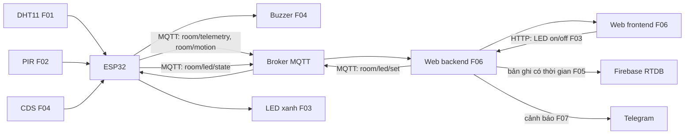

# ĐỀ XUẤT 03 — SMART CLASSROOM MONITORING SYSTEM

**Đề tài:** Hệ thống giám sát môi trường phòng học  
**Trường/Khoa/Lớp/Nhóm:** Nhóm bổ sung trước khi nộp  
**Thành viên tạm:** A, B, C  
**Hình thức:** Sản phẩm thật, mô hình điện áp thấp  
**Thời gian:** 4 tuần; mỗi thành viên 3 buổi/tuần, 2–3 giờ/buổi (tăng thêm 1 giờ/ngày so với mức 1–2 giờ/ngày trước đó).

Bản này theo [Yêu cầu thuyết minh dự án](<docs/CQ_YÊU CẦU THUYẾT MINH DỰ ÁN.pdf>) và [Quy định đồ án cuối kỳ](<docs/CQ_QUY ĐỊNH ĐỒ ÁN CUỐI KỲ.pdf>). Đây là phương án **ưu tiên theo quỹ thời gian**, chưa phải bản PDF nộp chính thức: cần bổ sung bìa, thông tin thành viên, ảnh 3D ngoài/trong, ảnh linh kiện và định dạng PDF theo quy định. Vì các chức năng đã cam kết trong thuyết minh chỉ được đổi tối đa một chức năng, nhóm nên xác nhận phạm vi trước khi nộp.

## 1. Giới thiệu

### 1.1. Tổng quan

Một ESP32 giám sát nhiệt độ/độ ẩm và chuyển động trong phòng học, đưa dữ liệu qua MQTT đến backend rồi hiển thị trên website. Người dùng bật/tắt đèn LED mô hình từ web; một cảm biến ánh sáng riêng kích còi khi phòng quá tối theo ngưỡng thử nghiệm. Backend lưu lịch sử lên cloud và gửi cảnh báo nhanh khi có chuyển động trong chế độ canh gác. Sản phẩm giúp người quản lý theo dõi trạng thái phòng từ xa và kiểm chứng hai chiều dữ liệu IoT với mô hình nhỏ, rẻ, dễ đóng hộp.

### 1.2. Danh sách chức năng

| ID | Loại, điểm tối đa theo C.1/C.2 | Thiết bị/dịch vụ | Luồng và kết quả kiểm chứng | Chủ sở hữu |
|---|---|---|---|---|
| F01 | Căn bản: input → web | DHT11 | DHT11 → ESP32 → MQTT → backend → frontend; hiện nhiệt độ, độ ẩm, thời điểm đo. | A |
| F02 | Căn bản: input → web | PIR HC-SR501 | PIR → ESP32 → MQTT → backend → frontend; hiện chuyển động/cập nhật mới nhất. | B |
| F03 | Căn bản: web → output | LED xanh | Frontend → backend → MQTT → ESP32 → LED; trả trạng thái bật/tắt thực tế. | C |
| F04 | Nâng cao #1, 1,5 điểm | Cảm biến ánh sáng CDS → buzzer | CDS → ESP32 → buzzer khi tối; thử ngưỡng tại chỗ, độc lập với LED F03. | C |
| F05 | Nâng cao #4, 1,5 điểm | Firebase RTDB | Backend lưu bản ghi DHT11/PIR và sự kiện LED theo thời gian. | A |
| F06 | Nâng cao #10, 2,0 điểm | Website tự xây | Tự xây backend/frontend, trang số đo, nút LED, trạng thái kết nối; không dùng Node-RED. | B |
| F07 | Nâng cao #6, 1,0 điểm | Telegram Bot | Backend gửi thông báo nhanh khi PIR báo chuyển động lúc bật chế độ canh gác, có chặn lặp. | C |

**Đối chiếu thiết bị:** F01 = DHT11, F02 = PIR, F03 = LED xanh, F04 = CDS và buzzer. Năm thiết bị input/output vật lý này **đôi một khác nhau**. F05–F07 là dịch vụ/chức năng phần mềm dùng dữ liệu có sẵn, không đăng ký thêm luồng thiết bị. F04 có đúng một người thực hiện. ESP32 là board trung gian, không tính như thiết bị input/output. Phương án dùng sản phẩm thật nên quy tắc thay thế thiết bị trong giả lập không áp dụng. Việc cloud/thông báo dùng lại dữ liệu F01/F02 cần được giảng viên xác nhận nếu quy định “thiết bị khác nhau” được hiểu bao gồm cả dữ liệu thứ cấp.

## 2. Thiết kế

### 2.1. Bố trí ngoài và trong

Mặt hộp có lỗ thoáng cho DHT11, cửa sổ hướng nhìn của PIR, lỗ ánh sáng cho CDS, LED và lỗ âm của buzzer. ESP32, dây tín hiệu và đầu nối đặt trong hộp; nguồn USB 5V cấp qua cổng của board. Không điều khiển tải điện lưới. DHT11 tránh gần nguồn nhiệt; PIR hướng về vùng cửa, CDS tránh bị LED F03 chiếu trực tiếp.

```text
Mặt ngoài: [DHT11 F01] [PIR F02] [CDS F04] [LED xanh F03] [buzzer F04]
Mặt trong: [ESP32] [dây + điện trở LED] [đầu nối] [cổng USB cấp nguồn]
```

Trước khi xuất PDF: dựng **hai hình 3D ngoài/trong** và đánh dấu từng vị trí F01–F04; đây là đầu ra của Tuần 4, chưa có trong bản khảo sát này.

### 2.2. Wireframe website

```text
┌──────────────────────────────────────────────────────────┐
│ GIÁM SÁT PHÒNG HỌC | ESP32/MQTT online hay offline       │
├─────────────────────────────┬────────────────────────────┤
│ Nhiệt độ/độ ẩm F01         │ Chuyển động F02            │
│ Cập nhật lần cuối           │ Cập nhật lần cuối          │
├─────────────────────────────┴────────────────────────────┤
│ Bật/tắt LED F03 | Bật/tắt chế độ canh gác cho F07       │
│ Lịch sử F05; trạng thái thông báo F07                    │
└──────────────────────────────────────────────────────────┘
```

Website F06 chỉ có các vùng liên quan đến F01–F03, F05 và F07. Chế độ canh gác là thiết lập phần mềm của cảnh báo F07, không thêm một thiết bị output.

### 2.3. Sơ đồ dữ liệu chung



MQTT chỉ truyền dữ liệu qua backend trước khi đến frontend. ESP32 công bố trạng thái LED thực sau lệnh để phân biệt lệnh gửi và tác động đã xảy ra. Khi broker mất kết nối, còi F04 vẫn chạy nội bộ; website hiển thị trạng thái mất kết nối.

### 2.4. Một số dự án ESP32 có mã nguồn đã khảo sát

| Dự án gốc | Có thể tham khảo | Khác biệt so với hai PDF |
|---|---|---|
| [Smart Classroom: MQTT + Flask](https://github.com/221110/IoT-Based-Smart-Classroom-Environment-Monitoring-and-Alert-System-With-Real-Time-Dashboard) | Có mã backend Flask và giao diện mẫu cho phòng học. | README xác nhận đây chỉ là bản giữa kỳ, MQTT dùng dữ liệu **mô phỏng**, chưa có phần cứng ESP32; chỉ tham khảo khung backend, phải tự làm firmware và kiểm chứng MQTT thật. |
| [SmartHome — ESP32 + MQTT + Flask](https://github.com/anjulameegalla/Group-Project-BTDT_24_51) | Có firmware, `app.py`, trang web; README mô tả cả chiều cảm biến → MQTT → Flask → web và web → Flask → MQTT → LED/relay. Đây là mẫu **gần nhất với C.1** của PDF quy định. | Repo dùng broker công khai và nhiều thiết bị; tách quyền sở hữu từng yêu cầu, không dùng lại input/output giữa F01–F04, giữ cấu hình mạng bí mật. |
| [IoT_Project — ESP32 + MQTT + Flask](https://github.com/PhucHuwu/IoT_Project) | Có thư mục `hardware`, `backend`, `frontend`, mã `.ino` và topic MQTT telemetry/control/action-history; hữu ích cho F01–F03 và F06. | Bản gốc dùng MongoDB, nhiều LED; đề xuất này giữ một LED cho F03 và Firebase RTDB cho F05, không sao chép nguyên kiến trúc nặng. |
| [Greenhouse Monitor — MQTT + Node.js](https://github.com/danieladarve/greenhouse-monitor) | Có firmware ESP32, backend, dashboard và Telegram với giới hạn tần suất; tham khảo cách kiểm thử F07 và xử lý bản ghi có thời gian. | Dự án gốc dùng ba ESP32 và Raspberry Pi; đề xuất phòng học chỉ cần một ESP32 và backend chạy trên máy nhóm. |
| [Smart Greenhouse System — ESP32 mô phỏng](https://github.com/Devenford/smart-greenhouse-system) | Có backend Node.js/MQTT và dữ liệu lịch sử, là mẫu tham khảo luồng cloud/dashboard. | README nói node cảm biến chạy trên Wokwi; không coi đây là bằng chứng vận hành phần cứng thật. |
| [EdgeGuard ESP32](https://github.com/AyushmanRaha/EdgeGuard-ESP32) | Firmware DHT11, cảm biến khác, điều khiển relay, giao diện web và kiểm thử logic. | Web gốc chạy trên ESP32 qua HTTP; không thay thế backend/MQTT bắt buộc của C.1. |
| [Smart Home IoT](https://github.com/DavidKShi/smart-home-iot) | DHT11, PIR, LED và dashboard đơn giản; phù hợp lắp mẫu đầu tiên. | Cần dựng backend trung gian và MQTT, phân quyền sở hữu từng chức năng. |
| [Smart Dustbin](https://github.com/shm230605/Smart-Dustbin-System) | Phương án khác: thùng rác tự mở nắp, đo mức đầy, có firmware và mô phỏng. | Cần bổ sung backend MQTT và một output web độc lập; cơ khí nắp tăng rủi ro lịch 4 tuần. |
| [Car Parking System](https://github.com/O2sa/Car-Parking-System) | Phương án khác: HC-SR04, servo, mô hình bãi xe và code ESP32. | Mẫu gốc dùng web server trên ESP32, không có backend MQTT; hai cảm biến/servo và cơ khí làm phương án này nặng hơn. |

**Xếp hạng theo quỹ giờ:** phòng học (ưu tiên) → thùng rác → bãi xe. Đây là suy luận từ số linh kiện, công cơ khí và mức sửa kiến trúc cần thiết; không phải kết quả thử nghiệm độc lập. Nhờ hai repo SmartHome và IoT_Project, phương án phòng học có nguồn tham khảo rõ cho luồng C.1, nhưng nhóm vẫn phải tự triển khai, kiểm thử và ghi nguồn trong báo cáo để bảo đảm tính trung thực.

## 3. Triển khai

### 3.1. Linh kiện và dự toán

Giá tham khảo tra ngày **28/10/2026**, đơn vị VND. Link sản phẩm có ảnh linh kiện để nhóm chèn vào PDF. Giá vận chuyển và vật tư mô hình chưa được xác minh.

| STT | Linh kiện | SL | Đơn giá | Thành tiền | Nguồn giá/tình trạng | ID |
|---|---|---:|---:|---:|---|---|
| 1 | ESP32 DevKit V1 | 1 | 140.000 | 140.000 | [Linh Kiện Việt Nam](https://linhkienvietnam.vn/module-node-mcu-32s-esp32-devkitc-dung-module-esp-wroom-32) | F01–F04 |
| 2 | DHT11 ASAIR | 1 | 27.000 | 27.000 | [Hshop](https://hshop.vn/cam-bien-do-am-nhiet-do-dht11) | F01 |
| 3 | PIR HC-SR501 | 1 | 27.000 | 27.000 | [Hshop](https://hshop.vn/cam-bien-chuyen-dong-pir-5v-2) | F02 |
| 4 | LED xanh + điện trở | 1 bộ | 8.000 | 8.000 | **Ước tính**, chọn đúng điện trở khi lắp | F03 |
| 5 | CDS Light Sensor | 1 | 15.000 | 15.000 | [Hshop](https://hshop.vn/cam-bien-anh-sang-quang-tro-2) | F04 |
| 6 | Buzzer 5VDC | 1 | 15.000 | 15.000 | **Ước tính**, [mẫu tham khảo](https://hshop.vn/coi-buzzer-5vdc) | F04 |
| 7 | Adapter 5V 2A | 1 | 30.000 | 30.000 | [Linh Kiện Việt Nam](https://linhkienvietnam.vn/nguon-adapter-5v-2a-5v2a-kho-b-ka9h14); cần dây/đầu USB phù hợp | F01–F04 |
| 8 | Hộp, dây, breadboard hoặc PCB đục lỗ | 1 bộ | 60.000 | 60.000 | **Ước tính**, chọn kích thước sau khi bố trí | F01–F04 |
| | **Tổng tham khảo** | | | **322.000** | Chưa gồm vận chuyển, công cụ và dịch vụ | |

Firebase và Telegram dự kiến dùng mức miễn phí nếu phù hợp hạn mức thực tế. Không cấp trực tiếp buzzer/LED vượt khả năng GPIO; kiểm tra dòng, điện trở và driver theo linh kiện mua được.

### 3.2. Kế hoạch thực hiện và kiểm tra sức chứa thời gian

Giả định mỗi người tăng thêm một giờ so với mức 1–2 giờ/ngày trước đó: **3 người × 3 buổi/tuần × 2–3 giờ/buổi × 4 tuần = 72–108 giờ-người** (mức giữa **90 giờ-người**). Ước lượng dưới đây là giờ làm tập trung, không tính chờ giao hàng; một số phần chạy song song.

| Tuần | ID | Công việc và đầu ra kiểm chứng | Chủ sở hữu | Ước giờ |
|---|---|---|---|---:|
| 1 | F01 | Lắp DHT11, firmware publish MQTT, backend nhận và frontend hiện số đo | A | 6–8 |
| 1 | F02 | Lắp PIR, publish MQTT, backend/frontend hiện sự kiện; dựng khung website F06 | B | 6–8 |
| 2 | F03 | Lệnh từ frontend qua backend/MQTT tới LED, nhận trạng thái xác nhận | C | 5–7 |
| 2 | F04 | CDS → buzzer, thử ngưỡng và thử khi ngắt WiFi | C | 3–5 |
| 2–3 | F05 | Lưu bản ghi theo thời gian trên Firebase, đọc lại mẫu dữ liệu | A | 5–7 |
| 2–3 | F06 | Hoàn thiện website tự xây, cập nhật online/offline, tích hợp API của A/C | B | 7–9 |
| 3 | F07 | Telegram Bot, chế độ canh gác và giới hạn gửi lặp | C | 3–5 |
| 4 | F01–F07 | Tích hợp, kiểm thử toàn luồng, đóng hộp, ảnh 3D, ảnh linh kiện, thuyết minh/PDF, tập vấn đáp | A điều phối; B/C cùng làm | 10–14 |
| | | **Tổng ước tính** | | **45–63** |

**Kết luận khả thi:** F01–F07 cần **45–63 giờ-người**, thấp hơn quỹ mới **72–108 giờ-người**; còn khoảng **9–63 giờ-người** để xử lý lỗi, hoàn thiện mô hình và tập vấn đáp. Ở mức giữa 90 giờ, dự phòng là 27–45 giờ, nên phương án phòng học có khả năng hoàn thành trong 4 tuần nếu mua linh kiện ở Tuần 1. Đây là ước lượng, chưa phải thời gian đã đo khi triển khai. Quỹ mới cho phép **xem xét** thêm yêu cầu nâng cao để cải thiện điểm, nhưng phải chọn và ước giờ trước khi nộp thuyết minh; sau đó PDF chỉ cho điều chỉnh tối đa một chức năng. Bảng F01–F07 hiện chưa đạt 4 điểm nâng cao/người. Nếu muốn cả ba người đạt mức đó, cần lập phiên bản chức năng và dự toán mới; không tự động coi thời gian dự phòng là đủ cho các chức năng chưa định nghĩa.

## 4. Tổng kết và phân chia công việc

Theo C.1 của [Quy định đồ án cuối kỳ](<docs/CQ_QUY ĐỊNH ĐỒ ÁN CUỐI KỲ.pdf>), mỗi người có một luồng căn bản qua MQTT, backend và frontend; tối đa **4 điểm chức năng + 1 điểm tích hợp nhóm** nếu làm và giải thích được. C.2 cho phép tối đa **4 điểm nâng cao/người**, nhưng điểm dự kiến ở đây chỉ cộng những yêu cầu đã phân công; không coi điểm là được bảo đảm. Điểm báo cáo cuối kỳ tối đa 1 và khoản cộng xét tối đa 1 cho sản phẩm thật nằm ngoài bảng. Công thức cuối kỳ còn nhân hệ số hiểu bài **K** theo vấn đáp.

| Thành viên | ID và phần bàn giao chính | Căn bản gồm nhóm | Nâng cao | Tổng tạm tính chưa gồm báo cáo |
|---|---|---:|---:|---:|
| A | F01 firmware/backend DHT11; F05 lưu cloud | 5,0 | 1,5 | 6,5 |
| B | F02 PIR; F06 website tự xây | 5,0 | 2,0 | 7,0 |
| C | F03 LED; F04 CDS → buzzer; F07 Telegram | 5,0 | 2,5 | 7,5 |

**Rà soát trước nộp:** xác nhận cách chấm dữ liệu F05/F07; đo giờ thực tế nhóm có thể làm; kiểm tra năm thiết bị F01–F04 không trùng; thử mọi luồng qua MQTT/backend/frontend; chèn ảnh 3D ngoài/trong, ảnh linh kiện có ID, màu mũi tên phân biệt trong sơ đồ; điền bìa và xuất PDF đúng tên `MANHOM_MSSV1_MSSV2_MSSV3_PROPOSAL.PDF`, Times New Roman 13, giãn dòng 1,15, canh đều.
