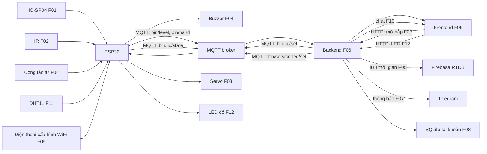

# ĐỀ XUẤT 04 — SMART WASTE BIN SYSTEM

**Đề tài:** Thùng rác thông minh giám sát mức đầy  
**Trường/Khoa/Lớp/Nhóm:** Nhóm bổ sung  
**Thành viên tạm:** A, B, C  
**Hình thức:** Sản phẩm thật, điện áp thấp  
**Thời gian:** 5 tuần; 3 buổi/tuần × 2–3 giờ/buổi/người cho phương án điểm nâng cao tối đa.

Theo [Yêu cầu thuyết minh dự án](<docs/CQ_YÊU CẦU THUYẾT MINH DỰ ÁN.pdf>) và [Quy định đồ án cuối kỳ](<docs/CQ_QUY ĐỊNH ĐỒ ÁN CUỐI KỲ.pdf>). Đây là bản khảo sát để chọn đề tài; trước khi nộp phải thêm bìa, tên/MSSV, ảnh 3D ngoài/trong, ảnh linh kiện và xuất PDF đúng định dạng. Chỉ được đổi tối đa một chức năng sau khi chốt thuyết minh.

## 1. Giới thiệu

### 1.1. Tổng quan

Mô hình thùng rác đo khoảng cách đến mặt rác để ước lượng mức đầy và phát hiện bàn tay ở gần nắp bằng cảm biến hồng ngoại riêng. Dữ liệu từ ESP32 đi qua MQTT, backend đến website. Người quản lý có thể ra lệnh mở nắp bằng servo từ web; một công tắc từ gắn ở nắp sẽ kích buzzer khi nắp bị giữ mở quá lâu. Backend lưu lịch sử và gửi Telegram khi thùng gần đầy. Mô hình tập trung vào theo dõi trạng thái, điều khiển và cảnh báo; cơ cấu nắp dùng bìa cứng/nhựa nhẹ để giảm tải servo.

### 1.2. Danh sách chức năng

| ID | Loại, điểm theo PDF | Thiết bị/dịch vụ | Luồng và đầu ra kiểm chứng | Chủ sở hữu |
|---|---|---|---|---|
| F01 | Căn bản input → web | HC-SR04 đo mức đầy | Cảm biến → ESP32 → MQTT → backend → frontend hiện khoảng cách/% đầy. | A |
| F02 | Căn bản input → web | Cảm biến vật cản IR | IR → ESP32 → MQTT → backend → frontend hiện có/không có tay gần nắp. | B |
| F03 | Căn bản web → output | Servo SG90 | Frontend → backend → MQTT → ESP32 → servo mở nắp tối đa vài giây rồi đóng; phản hồi trạng thái. | C |
| F04 | Nâng cao #1, 1,5 điểm | Công tắc từ → buzzer | Công tắc từ ở nắp → ESP32 → buzzer nếu nắp mở quá thời gian, chạy cục bộ khi mất mạng. | A |
| F05 | Nâng cao #4, 1,5 điểm | Firebase RTDB | Backend lưu mức đầy và sự kiện mở nắp theo thời gian. | B |
| F06 | Nâng cao #10, 2,0 điểm | Website tự xây | Backend/frontend hiển thị F01–F03, lịch sử F05, nút mở nắp; không dùng Node-RED. | B |
| F07 | Nâng cao #6, 1,0 điểm | Telegram Bot | Backend cảnh báo thùng gần đầy liên tục, giới hạn gửi lặp. | C |
| F08 | Nâng cao #9, 1,5 điểm | SQLite tài khoản | A làm đăng ký/đăng nhập, băm mật khẩu, bảo vệ lệnh mở nắp và lịch sử. | A |
| F09 | Nâng cao #12, 1,0 điểm | WiFiManager, sản phẩm thật | A cho nhập WiFi mới tại ESP32, thử kết nối lại MQTT. | A |
| F10 | Nâng cao #8, 0,5 điểm | Chatbot luật điều kiện | B cho ô chat trả lời mức đầy/trạng thái nắp từ backend theo câu hỏi định sẵn. | B |
| F11 | Nâng cao #2, 1,5 điểm | DHT11 riêng → web | C đo nhiệt độ/độ ẩm trong thùng → ESP32 → MQTT → backend → frontend. | C |
| F12 | Nâng cao #3, 1,5 điểm | LED đỏ bảo trì | C làm nút bật/tắt LED bảo trì trên web → backend → MQTT → ESP32 → LED; LED khác buzzer/servo. | C |

**Kiểm tra thiết bị:** F01 = HC-SR04, F02 = IR, F03 = SG90, F04 = công tắc từ **và** buzzer, F11 = DHT11, F12 = LED đỏ. Bảy thiết bị input/output này đôi một khác nhau; mỗi yêu cầu nâng cao có đúng một người phụ trách. F05–F10 là dịch vụ/phần mềm. Đây là sản phẩm thật; nếu chuyển sang giả lập phải kiểm giới hạn một thiết bị thay thế. Việc cloud/thông báo dùng lại dữ liệu F01/F03 cần xác nhận nếu giảng viên hiểu quy tắc “khác thiết bị” bao gồm dữ liệu thứ cấp.

## 2. Thiết kế

### 2.1. Bố trí ngoài và trong

HC-SR04 đặt dưới mặt nắp, hướng xuống lòng thùng; IR hướng ra trước để nhận biết tay; công tắc từ gắn giữa nắp và thân, tách khỏi vùng quét IR. Servo nối bản lề nắp nhẹ. DHT11 F11 đặt trong hộp cảm biến thoáng, tránh nước và rác; LED đỏ F12 đặt ở mặt trước. ESP32, dây, nguồn và buzzer ở hộp khô phía sau. HC-SR04 loại thông dụng có chân Echo mức 5V; dùng chia áp/level shifter trước chân GPIO ESP32. Servo cấp nguồn 5V riêng phù hợp dòng, nối chung mass với ESP32; không kéo dòng servo từ GPIO.

```text
Ngoài: [IR F02] [nắp + công tắc từ F04] [lỗ âm buzzer F04] [LED đỏ F12] [DHT11 F11]
Trong nắp: [HC-SR04 F01 hướng xuống] [servo SG90 F03]
Hộp khô sau thùng: [ESP32] [chia áp Echo] [nguồn 5V] [đầu nối]
```

Khi xuất PDF cần hình 3D cả ngoài và trong, đánh dấu ID của từng linh kiện.

### 2.2. Wireframe website

```text
┌─────────────────────────────────────────────────────────┐
│ THÙNG RÁC THÔNG MINH — MQTT online/offline | F08          │
├───────────────────────┬─────────────────────────────────┤
│ Mức đầy F01           │ Tay gần nắp F02                │
│ Cảnh báo F07          │ Nút MỞ NẮP F03; trạng thái nắp │
├───────────────────────┴─────────────────────────────────┤
│ Lịch sử F05; nhiệt độ/độ ẩm F11; nút LED F12            │
│ Ô chat F10: hỏi mức đầy và lần mở nắp gần nhất           │
└─────────────────────────────────────────────────────────┘
```

### 2.3. Sơ đồ truyền và nhận dữ liệu



Nắp tự đóng theo bộ đếm trên ESP32 dù backend mất mạng. Buzzer F04 cũng chạy cục bộ. Backend gửi trạng thái offline nếu quá thời gian không nhận telemetry.

F09 mở cấu hình WiFi khi đổi mạng; F10 trả lời theo luật điều kiện. DHT11 F11 đặt trong vùng thoáng của hộp cảm biến, tránh nước/rác trực tiếp; LED F12 nằm mặt trước. Các thẻ số đo, nút LED, đăng nhập và ô chat đã có trong phác thảo; ghi màu/mẫu mũi tên khi xuất PDF.

### 2.4. Dự án tương tự có mã nguồn

| Nguồn | Phần hữu ích | Điều chỉnh theo hai PDF |
|---|---|---|
| [Smart Dustbin System](https://github.com/shm230605/Smart-Dustbin-System) | Có mã ESP32, sơ đồ, Wokwi, HC-SR04, servo và cảnh báo. | Bản gốc không có đúng luồng MQTT → backend → frontend và web → output; phải tự xây F01–F03 theo C.1. |
| [IoT Smart Waste Bin](https://github.com/PamudaUposath/iot-smart-waste-bin) | Firmware ESP32, MQTT, điều khiển nắp và mức đầy. | Dashboard gốc dùng Node-RED; F06 của đề xuất phải là website tự xây. |
| [SmartHome ESP32 + Flask](https://github.com/anjulameegalla/Group-Project-BTDT_24_51) | Mẫu kiến trúc MQTT hai chiều qua backend Flask. | Chỉ tham khảo kiến trúc; thay cảm biến và tách thiết bị theo từng ID của thùng rác. |

Các repo là nguồn học tập, không chứng minh mô hình của nhóm đã chạy; cần tự tích hợp, kiểm thử và trích dẫn trung thực.

## 3. Triển khai

### 3.1. Linh kiện và dự toán

Giá tham khảo tra ngày **28/10/2026**, VND. Link sản phẩm có ảnh để chèn vào PDF. Các khoản ghi “ước tính” cần tra báo giá trước khi mua.

| STT | Linh kiện | SL | Đơn giá | Thành tiền | Nguồn giá/tình trạng | ID |
|---|---|---:|---:|---:|---|---|
| 1 | ESP32 DevKit V1 | 1 | 140.000 | 140.000 | [Linh Kiện Việt Nam](https://linhkienvietnam.vn/module-node-mcu-32s-esp32-devkitc-dung-module-esp-wroom-32) | F01–F04 |
| 2 | HC-SR04 | 1 | 27.000 | 27.000 | [Hshop](https://hshop.vn/cam-bien-sieu-am-srf04) | F01 |
| 3 | IR phát hiện vật cản | 1 | 15.000 | 15.000 | [Hshop](https://hshop.vn/cam-bien-vat-can-hong-ngoai-v1-2) | F02 |
| 4 | Servo SG90 | 1 | 42.000 | 42.000 | [Hshop](https://hshop.vn/dong-co-rc-servo-9g) | F03 |
| 5 | Công tắc từ MC-38 | 1 | 12.000 | 12.000 | [Shopee](https://shopee.vn/C%E1%BA%A3m-bi%E1%BA%BFn-c%E1%BB%ADa-MC-38-%28t%E1%BB%AB-tr%C6%B0%E1%BB%9Dng%29-TH334-i.310609561.3173442342); kiểm tra biến thể | F04 |
| 6 | Buzzer 5V | 1 | 15.000 | 15.000 | **Ước tính**, [mẫu](https://hshop.vn/coi-buzzer-5vdc) | F04 |
| 7 | Adapter 5V 2A + dây/đầu cấp nguồn | 1 bộ | 40.000 | 40.000 | [Adapter 30.000đ](https://linhkienvietnam.vn/nguon-adapter-5v-2a-5v2a-kho-b-ka9h14) + dây ước tính 10.000đ | F01–F04 |
| 8 | Hộp/thùng mô hình, bản lề, dây, chia áp/PCB | 1 bộ | 100.000 | 100.000 | **Ước tính**, cần chọn sau khi đo kích thước | F01–F04 |
| 9 | DHT11 | 1 | 27.000 | 27.000 | [Hshop](https://hshop.vn/cam-bien-do-am-nhiet-do-dht11) | F11 |
| 10 | LED đỏ và điện trở | 1 bộ | 8.000 | 8.000 | **Ước tính**, kiểm điện trở trước khi cấp nguồn | F12 |
| | **Tổng tham khảo** | | | **426.000** | Chưa gồm vận chuyển/công cụ/dịch vụ | |

### 3.2. Kế hoạch 5 tuần và mốc nền 4 tuần

Quỹ nhóm: **3 người × 3 ngày/tuần × 2–3 giờ/ngày × 4 tuần = 72–108 giờ-người**. Dự toán công cho F01–F07 khoảng **60–82 giờ-người**, gồm lắp cơ khí, website, cloud, cảnh báo, kiểm thử và PDF. Mốc dưới 72 giờ vẫn có rủi ro nếu nắp kẹt hoặc giao hàng chậm.

| Tuần | ID | Đầu ra kiểm chứng | Chủ sở hữu | Giờ ước tính |
|---|---|---|---|---:|
| 1 | F01, F04 | Chốt cơ khí; mức đầy MQTT → web; công tắc từ → buzzer | A | 12–16 |
| 1–2 | F02, F05, F06 | IR MQTT → web; khung backend/frontend; lưu lịch sử Firebase | B | 14–19 |
| 2 | F03 | Web → MQTT → servo; tự đóng khi hết thời gian | C | 10–14 |
| 3 | F06, F07 | Tích hợp dashboard, Telegram; thử quá mức đầy/mất kết nối | B cho F06; C cho F07 | 10–13 |
| 4 | F01–F07 | Hoàn thiện nắp/hộp, kiểm tra toàn luồng, hình 3D/ảnh linh kiện, PDF và vấn đáp | A điều phối; B/C hỗ trợ | 14–20 |
| | | **Tổng** | | **60–82** |

Mỗi ID chỉ có một chủ sở hữu; dòng Tuần 4 là công tích hợp chung. Ở mức 108 giờ có dự phòng 26–48 giờ, ở mức 72 giờ có thể thiếu tối đa 10 giờ. Chỉ nên chốt đề tài khi nhóm có thể dành gần **2,5–3 giờ/ngày/người** hoặc đã thử cơ khí nắp trước Tuần 1.

**Phần mở rộng F08–F12 để đạt trần:** F08 7–10 giờ (A), F09 4–6 giờ (A), F10 2–3 giờ (B), F11 4–6 giờ (C), F12 4–6 giờ (C), tích hợp/kiểm thử tăng thêm 4–6 giờ. Tổng cả đề tài **85–119 giờ-người**. Lịch 4 tuần 72–108 giờ không đủ chắc chắn; chuyển sang **5 tuần = 90–135 giờ-người**. Tuần 4 làm F08/F09/F11/F12, Tuần 5 làm F10, kiểm thử, đóng hộp và PDF; dòng tích hợp cuối Tuần 4 ở bảng nền chuyển sang Tuần 5. Mỗi ID nâng cao vẫn chỉ một chủ sở hữu.

| Tuần mở rộng | ID | Chủ sở hữu | Giờ | Đầu ra kiểm chứng |
|---|---|---|---:|---|
| 4 | F08, F09 | A | 11–16 | Tài khoản bảo vệ lệnh mở nắp; đổi WiFi và nối lại MQTT |
| 5 | F10 | B | 2–3 | Chatbot trả lời theo trạng thái thùng |
| 4 | F11, F12 | C | 8–12 | DHT11 lên web; lệnh web điều khiển LED riêng |
| 5 | F01–F12 | Cả nhóm | 4–6 tăng thêm | Thử toàn luồng và hoàn thiện PDF, ngoài giờ tích hợp nền |

## 4. Tổng kết và phân chia công việc

Theo C.1 của [Quy định đồ án cuối kỳ](<docs/CQ_QUY ĐỊNH ĐỒ ÁN CUỐI KỲ.pdf>), mỗi người có một luồng căn bản; điểm tối đa khi làm và giải thích được là **4 chức năng + 1 tích hợp nhóm**. C.2 tối đa **4 nâng cao/người**; bản này phân bổ đủ mức trần dự kiến. Điểm báo cáo tối đa 1 và khoản cộng xét sản phẩm thật tối đa 1 tính riêng; điểm cuối kỳ còn phụ thuộc hệ số hiểu bài K.

| Thành viên | ID và bàn giao | Căn bản gồm nhóm | Nâng cao | Tổng tạm tính chưa gồm báo cáo |
|---|---|---:|---:|---:|
| A | F01; F04 công tắc từ/buzzer 1,5 + F08 bảo mật 1,5 + F09 WiFi 1,0 | 5,0 | 4,0 | 9,0 |
| B | F02; F05 Firebase 1,5 + F06 website 2,0 + F10 chatbot 0,5 | 5,0 | 4,0 | 9,0 |
| C | F03; F07 Telegram 1,0 + F11 DHT11 → web 1,5 + F12 web → LED 1,5 | 5,0 | 4,0 | 9,0 |

**Rà soát nộp:** bảy thiết bị F01–F04/F11/F12 đôi một khác nhau; một chủ sở hữu/ID; ảnh 3D ngoài/trong và ảnh linh kiện có ID; sơ đồ duy nhất có mũi tên/màu phân biệt; giá có link; thử nắp khi mất MQTT; PDF đúng tên `MANHOM_MSSV1_MSSV2_MSSV3_PROPOSAL.PDF`, Times New Roman 13, giãn dòng 1,15, canh đều.
