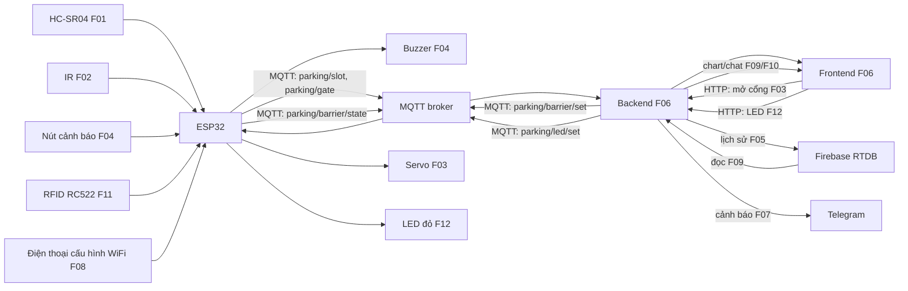

# ĐỀ XUẤT 05 — SMART PARKING SYSTEM

**Đề tài:** Mô hình bãi đỗ xe thông minh một chỗ  
**Trường/Khoa/Lớp/Nhóm:** Nhóm bổ sung  
**Thành viên tạm:** A, B, C  
**Hình thức:** Sản phẩm thật, mô hình điện áp thấp  
**Thời gian:** 6 tuần; 3 buổi/tuần × 2–3 giờ/buổi/người cho phương án điểm nâng cao tối đa.

Theo [Yêu cầu thuyết minh dự án](<docs/CQ_YÊU CẦU THUYẾT MINH DỰ ÁN.pdf>) và [Quy định đồ án cuối kỳ](<docs/CQ_QUY ĐỊNH ĐỒ ÁN CUỐI KỲ.pdf>). Đây là bản khảo sát để chọn đề tài; trước khi nộp cần bìa, họ tên/MSSV, ảnh 3D ngoài/trong, ảnh linh kiện và PDF đúng định dạng. Sau khi chốt thuyết minh chỉ được đổi tối đa một chức năng.

## 1. Giới thiệu

### 1.1. Tổng quan

Mô hình bãi đỗ một chỗ dùng HC-SR04 đo có xe tại ô đỗ, cảm biến IR riêng phát hiện xe tại cổng. ESP32 gửi hai trạng thái qua MQTT đến backend và website. Người quản lý mở thanh chắn bằng nút web; servo tự đóng sau thời gian giới hạn. Nút cảnh báo ở mô hình kích buzzer tại chỗ, hoạt động kể cả khi Internet mất. Backend lưu lịch sử vào cloud và gửi Telegram nếu ô đã có xe nhưng vẫn xuất hiện xe tại cổng. Phạm vi một chỗ giúp nhóm tập trung làm đúng luồng môn học và cơ khí thanh chắn.

### 1.2. Danh sách chức năng

| ID | Loại, điểm theo PDF | Thiết bị/dịch vụ | Luồng và đầu ra kiểm chứng | Chủ sở hữu |
|---|---|---|---|---|
| F01 | Căn bản input → web | HC-SR04 tại ô đỗ | HC-SR04 → ESP32 → MQTT → backend → frontend hiện ô trống/có xe. | A |
| F02 | Căn bản input → web | IR tại cổng | IR → ESP32 → MQTT → backend → frontend hiện xe đang chờ ở cổng. | B |
| F03 | Căn bản web → output | Servo SG90 + thanh chắn | Frontend → backend → MQTT → ESP32 → servo mở thanh chắn trong thời gian giới hạn; báo trạng thái thực. | C |
| F04 | Nâng cao #1, 1,5 điểm | Nút nhấn cảnh báo → buzzer | Nút nhấn riêng → ESP32 → buzzer báo tại chỗ, không điều khiển servo F03. | A |
| F05 | Nâng cao #4, 1,5 điểm | Firebase RTDB | Backend lưu sự kiện ô đỗ, cổng và lệnh mở theo thời gian. | A |
| F06 | Nâng cao #10, 2,0 điểm | Website tự xây | Backend/frontend có hai trạng thái, nút mở thanh chắn và lịch sử; không dùng Node-RED. | B |
| F07 | Nâng cao #6, 1,0 điểm | Telegram Bot | Backend cảnh báo khi xe chờ ở cổng lúc ô đang có xe, có chặn gửi lặp. | C |
| F08 | Nâng cao #12, 1,0 điểm | WiFiManager, sản phẩm thật | A cho nhập WiFi mới trên ESP32 và kiểm tra kết nối lại MQTT. | A |
| F09 | Nâng cao #5, 1,5 điểm | Firebase RTDB | B đọc lịch sử F05 từ cloud qua backend và hiển thị chart lượt xe theo giờ/ngày. | B |
| F10 | Nâng cao #8, 0,5 điểm | Chatbot luật điều kiện | B trả lời trạng thái ô đỗ/cổng gần nhất theo câu hỏi định sẵn. | B |
| F11 | Nâng cao #2, 1,5 điểm | RFID RC522 riêng → web | C đọc thẻ tại cổng → ESP32 → MQTT → backend → frontend ghi UID rút gọn và thời điểm quét. | C |
| F12 | Nâng cao #3, 1,5 điểm | LED đỏ trạng thái cổng | C làm nút bật/tắt đèn báo trên web → backend → MQTT → ESP32 → LED; LED khác servo/buzzer. | C |

**Kiểm tra thiết bị:** F01 = HC-SR04, F02 = IR, F03 = servo SG90, F04 = nút nhấn **và** buzzer, F11 = đầu đọc RFID RC522, F12 = LED đỏ. Bảy thiết bị input/output này đôi một khác nhau; thẻ RFID là vật mang mã cho F11. Mỗi yêu cầu nâng cao có đúng một chủ sở hữu. F05–F10 là dịch vụ/phần mềm. Sản phẩm thật nên quy tắc thay thế giả lập không áp dụng; dữ liệu F01/F02 dùng cho cloud/cảnh báo cần xác nhận cách hiểu với giảng viên.

## 2. Thiết kế

### 2.1. Bố trí ngoài và trong

HC-SR04 hướng ngang hoặc từ trên xuống ô đỗ để nhận biết xe mô hình; IR đặt trước cổng, tránh tia phản xạ từ thanh chắn. Servo gắn trục của thanh chắn nhẹ, có chặn cơ khí để không vượt góc. Nút cảnh báo và buzzer ở cạnh trước mô hình. RC522 F11 đặt trước thanh chắn; LED đỏ F12 đặt cạnh cổng, cách buzzer F04. ESP32, mạch chia áp Echo của HC-SR04, đầu nối và nguồn đặt dưới đế bãi xe. Servo cấp 5V đủ dòng, chung mass với ESP32; Echo 5V qua chia áp trước GPIO 3,3V.

```text
Mặt trên: [ô đỗ + HC-SR04 F01] [cổng + IR F02 + servo/thanh chắn F03 + RC522 F11 + LED F12]
Cạnh trước: [nút cảnh báo F04] [buzzer F04]
Dưới đế: [ESP32] [mạch chia áp Echo] [nguồn 5V] [dây/đầu nối]
```

Khi xuất PDF, dựng hình 3D ngoài và trong, ghi ID từng linh kiện.

### 2.2. Wireframe website

```text
┌─────────────────────────────────────────────────────────┐
│ BÃI ĐỖ 1 CHỖ — ESP32/MQTT online/offline                │
├─────────────────────────┬───────────────────────────────┤
│ Ô đỗ trống/có xe F01    │ Xe chờ ở cổng F02           │
│ Cảnh báo F07            │ MỞ THANH CHẮN F03           │
├─────────────────────────┴───────────────────────────────┤
│ Lịch sử F05; chart cloud F09; lần quét RFID F11         │
│ Ô chat F10; nút bật/tắt LED F12                          │
└─────────────────────────────────────────────────────────┘
```

### 2.3. Sơ đồ truyền và nhận dữ liệu



ESP32 tự đóng thanh chắn sau bộ đếm cục bộ. Nút F04 chỉ kích buzzer riêng, không tham gia luồng servo F03. Backend phân biệt lệnh gửi và trạng thái servo đã phản hồi. Cảnh báo F07 kiểm tra kết hợp hai trạng thái, không dùng thêm input/output mới.

F08 cấu hình WiFi khi đổi mạng; RFID F11 đặt trước thanh chắn, LED F12 ở cổng nhưng khác buzzer F04. Chart, chat, lần quét RFID và nút LED đã có trong phác thảo; khi xuất PDF dùng màu/mẫu mũi tên khác nhau cho các luồng.

### 2.4. Dự án tương tự có mã nguồn

| Nguồn | Phần hữu ích | Điều chỉnh theo hai PDF |
|---|---|---|
| [Car Parking System](https://github.com/O2sa/Car-Parking-System) | Có firmware ESP32, hai HC-SR04, servo, hình/sơ đồ và giao diện bãi xe. | Website gốc chạy trên ESP32, cần chuyển sang MQTT → backend → frontend; mô hình đề xuất chỉ một ô. |
| [SmartParking: ESP32 + MQTT + Go + React](https://github.com/NiflheimDevs/SmartParking) | Có thư mục phần cứng, backend và frontend, MQTT và servo; tham khảo kiến trúc sát C.1. | Quy mô/stack lớn; nhóm có thể dùng backend đơn giản hơn, giữ một sensor cho mỗi yêu cầu. |
| [Smart Parking Gate](https://github.com/Nathanael1721/Smart-Parking-Gate) | Có Flask, mã ESP32/MicroPython, servo và topic lệnh MQTT. | Cần kiểm tra luồng input F01/F02 qua backend, không chép nguyên camera/streaming. |

Nguồn là mã tham khảo từng phần; nhóm phải tự lắp, kiểm thử và giải thích được luồng mình phụ trách.

## 3. Triển khai

### 3.1. Linh kiện và dự toán

Giá VND tham khảo ngày **28/10/2026**. Link sản phẩm có ảnh để đưa vào PDF; giá ước tính cần báo giá lại, chưa gồm vận chuyển/công cụ.

| STT | Linh kiện | SL | Đơn giá | Thành tiền | Nguồn giá/tình trạng | ID |
|---|---|---:|---:|---:|---|---|
| 1 | ESP32 DevKit V1 | 1 | 140.000 | 140.000 | [Linh Kiện Việt Nam](https://linhkienvietnam.vn/module-node-mcu-32s-esp32-devkitc-dung-module-esp-wroom-32) | F01–F04 |
| 2 | HC-SR04 | 1 | 27.000 | 27.000 | [Hshop](https://hshop.vn/cam-bien-sieu-am-srf04) | F01 |
| 3 | IR phát hiện vật cản | 1 | 15.000 | 15.000 | [Hshop](https://hshop.vn/cam-bien-vat-can-hong-ngoai-v1-2) | F02 |
| 4 | Servo SG90 | 1 | 42.000 | 42.000 | [Hshop](https://hshop.vn/dong-co-rc-servo-9g) | F03 |
| 5 | Nút nhấn nhả + dây | 1 bộ | 5.000 | 5.000 | **Ước tính**, chọn loại phù hợp hộp | F04 |
| 6 | Buzzer 5V | 1 | 15.000 | 15.000 | **Ước tính**, [mẫu](https://hshop.vn/coi-buzzer-5vdc) | F04 |
| 7 | Adapter 5V 2A + dây/đầu cấp nguồn | 1 bộ | 40.000 | 40.000 | [Adapter 30.000đ](https://linhkienvietnam.vn/nguon-adapter-5v-2a-5v2a-kho-b-ka9h14) + dây ước tính 10.000đ | F01–F04 |
| 8 | Đế, mô hình ô đỗ/thanh chắn, chia áp, dây | 1 bộ | 120.000 | 120.000 | **Ước tính**, chọn sau khi vẽ kích thước | F01–F04 |
| 9 | RFID RC522 | 1 | 36.000 | 36.000 | [Hshop](https://hshop.vn/mach-rfid-rc522-nfc-13-56mhz) | F11 |
| 10 | Thẻ/móc khóa RFID | 1 | 11.000 | 11.000 | [Shopee](https://shopee.vn/Th%E1%BA%BB-t%E1%BB%AB-RFID-IC-M1-13.56Mhz-m%C3%A0u-xanh-Lo%E1%BA%A1i-m%C3%B3c-kh%C3%B3a-i.119714962.22369848935); kiểm tra biến thể | F11 |
| 11 | LED đỏ + điện trở | 1 bộ | 8.000 | 8.000 | **Ước tính**, kiểm điện trở khi lắp | F12 |
| | **Tổng tham khảo** | | | **459.000** | Chưa gồm vận chuyển/công cụ/dịch vụ | |

### 3.2. Kế hoạch 6 tuần và mốc nền 4 tuần

Quỹ nhóm: **3 người × 3 ngày/tuần × 2–3 giờ/ngày × 4 tuần = 72–108 giờ-người**. Dự toán công **68–92 giờ-người**; phần cơ khí và độ ổn định cảm biến quyết định khả năng hoàn thành.

| Tuần | ID | Đầu ra kiểm chứng | Chủ sở hữu | Giờ ước tính |
|---|---|---|---|---:|
| 1 | F01, F04 | Lắp ô đỗ, HC-SR04 MQTT → web, nút cảnh báo → buzzer | A | 14–18 |
| 1–2 | F02, F06 | Lắp IR, MQTT → web; dựng backend/frontend | B | 15–20 |
| 2 | F03 | Servo/thanh chắn và lệnh web → MQTT → ESP32; tự đóng | C | 12–17 |
| 3 | F05, F06, F07 | Lưu cloud, hoàn thiện web, Telegram; thử tổ hợp trạng thái | A cho F05; B cho F06; C cho F07 | 13–17 |
| 4 | F01–F07 | Kiểm thử mất mạng/nút cảnh báo, sửa cơ khí, hộp, ảnh 3D, PDF, vấn đáp | A điều phối; B/C hỗ trợ | 14–20 |
| | | **Tổng** | | **68–92** |

Ở mức 72 giờ, nhóm chỉ đủ nếu mọi việc đi theo cận dưới; ở mức 108 giờ có 16–40 giờ dự phòng. Cần mua linh kiện và thử servo với thanh chắn ngay Tuần 1. Nếu chỉ chắc chắn làm 2 giờ/ngày, phương án phòng học là lựa chọn an toàn hơn.

**Phần mở rộng F08–F12 để đạt trần:** F08 WiFiManager 4–6 giờ (A), F09 chart cloud 5–7 giờ (B), F10 chatbot luật 2–3 giờ (B), F11 RFID → web 7–10 giờ (C), F12 web → LED 4–6 giờ (C), tích hợp/kiểm thử thêm 4–6 giờ. Tổng mới **94–130 giờ-người**. Lịch 4 tuần 72–108 giờ không đủ chắc chắn; chuyển sang **6 tuần = 108–162 giờ-người** để có dự phòng cơ khí. Tuần 4 làm F08/F09/F11; Tuần 5 làm F10/F12; Tuần 6 kiểm thử, đóng hộp, ảnh 3D và PDF. Dòng tích hợp cuối Tuần 4 trong bảng nền được chuyển sang Tuần 6.

| Tuần mở rộng | ID | Chủ sở hữu | Giờ | Đầu ra kiểm chứng |
|---|---|---|---:|---|
| 4 | F08 | A | 4–6 | Đổi WiFi và nối lại MQTT |
| 4–5 | F09, F10 | B | 7–10 | Chart từ Firebase; chatbot trả lời trạng thái ô đỗ |
| 4–5 | F11, F12 | C | 11–16 | Thẻ RFID hiện trên web; lệnh web bật/tắt LED riêng |
| 6 | F01–F12 | Cả nhóm | 4–6 tăng thêm | Thử toàn luồng/cơ khí và hoàn thiện PDF, ngoài giờ tích hợp nền |

## 4. Tổng kết và phân chia công việc

Theo C.1 của [Quy định đồ án cuối kỳ](<docs/CQ_QUY ĐỊNH ĐỒ ÁN CUỐI KỲ.pdf>), mỗi người có một luồng căn bản; tối đa **4 điểm chức năng + 1 điểm nhóm** nếu làm và giải thích được. C.2 tối đa **4 điểm nâng cao/người**; bản này phân bổ đủ mức trần dự kiến. Điểm báo cáo tối đa 1, khoản cộng xét sản phẩm thật tối đa 1 tính riêng; điểm cuối kỳ còn nhân hệ số hiểu bài K.

| Thành viên | ID và bàn giao | Căn bản gồm nhóm | Nâng cao | Tổng tạm tính chưa gồm báo cáo |
|---|---|---:|---:|---:|
| A | F01; F04 nút/buzzer 1,5 + F05 Firebase 1,5 + F08 WiFi 1,0 | 5,0 | 4,0 | 9,0 |
| B | F02; F06 website 2,0 + F09 chart cloud 1,5 + F10 chatbot 0,5 | 5,0 | 4,0 | 9,0 |
| C | F03; F07 Telegram 1,0 + F11 RFID → web 1,5 + F12 web → LED 1,5 | 5,0 | 4,0 | 9,0 |

**Rà soát nộp:** bảy thiết bị F01–F04/F11/F12 không trùng; đúng một chủ sở hữu/ID; ảnh ngoài/trong và ảnh linh kiện có ID; sơ đồ duy nhất có mũi tên/màu khác nhau theo luồng; giá có link; kiểm thử nút cảnh báo và phản hồi trạng thái servo; PDF tên `MANHOM_MSSV1_MSSV2_MSSV3_PROPOSAL.PDF`, Times New Roman 13, giãn dòng 1,15, canh đều.
