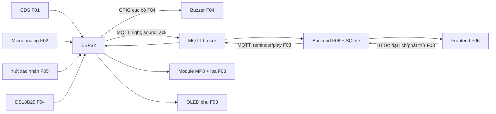

# ĐỀ XUẤT 06 — CHILD ROUTINE MONITORING SYSTEM

**Đề tài:** Thiết bị nhắc lịch và giám sát môi trường phòng trẻ  
**Trường/Khoa/Lớp/Nhóm:** Nhóm bổ sung trước khi nộp  
**Thành viên tạm:** A, B, C  
**Hình thức:** Sản phẩm thật, mô hình điện áp thấp  
**Thời gian dự kiến:** 3 tuần; mỗi người 3 buổi/tuần, 1–2 giờ/buổi.

Bản khảo sát này theo [Yêu cầu thuyết minh dự án](<docs/CQ_YÊU CẦU THUYẾT MINH DỰ ÁN.pdf>) và [Quy định đồ án cuối kỳ](<docs/CQ_QUY ĐỊNH ĐỒ ÁN CUỐI KỲ.pdf>). Khi nộp phải điền bìa, họ tên/MSSV, ảnh 3D trong/ngoài, ảnh linh kiện và xuất PDF đúng định dạng. Các chức năng đã cam kết chỉ được đổi tối đa một chức năng sau khi chốt thuyết minh.

## 1. Giới thiệu

### 1.1. Tổng quan

Một node ESP32 đặt trong phòng trẻ đo **mức sáng tương đối** và **biên độ âm thanh tương đối** rồi gửi qua MQTT → backend → website để phụ huynh xem biểu đồ. Phụ huynh đặt ba lịch mẫu “học bài”, “đi ngủ”, “làm việc nhà” trên backend; đến giờ, backend gửi lệnh MQTT để node phát tệp lời nhắc đã thu sẵn qua loa, đồng thời OLED hiện tên việc. Trẻ bấm nút để xác nhận; website ghi thời điểm bấm và trạng thái “trẻ đã xác nhận”, **không suy diễn rằng việc đã hoàn thành**. Một cảm biến nhiệt độ riêng kích buzzer tại chỗ khi vượt ngưỡng thử nghiệm, không cần Internet.

Đây là **bản thu gọn** để thử tính khả thi trong 3 tuần. Hệ thống **không tự xác định** trẻ đang dùng điện thoại/PC hoặc đang ngủ: các cảm biến ánh sáng, âm thanh và nút bấm không cung cấp bằng chứng trực tiếp cho hai kết luận ấy. Theo dõi thời gian dùng ứng dụng cần phần mềm và quyền truy cập trên chính điện thoại/PC; ví dụ iOS có [Screen Time API và Family Controls](https://developer.apple.com/documentation/screentimeapidocumentation). Xác định giấc ngủ cũng đòi hỏi thêm tín hiệu và thuật toán; [Sleep API của Android](https://developers.google.com/location-context/sleep) trả về xác suất thay vì khẳng định tuyệt đối. Hai ý tưởng này nằm ngoài bảng chức năng và dự toán hiện tại.

### 1.2. Danh sách chức năng

| ID | Loại, điểm theo PDF | Thiết bị/dịch vụ | Luồng và đầu ra kiểm chứng | Chủ sở hữu |
|---|---|---|---|---|
| F01 | Căn bản input → web | Cảm biến sáng CDS | CDS → ESP32 → MQTT → backend → frontend; hiện và ghi mức sáng tương đối theo thời gian. | A |
| F02 | Căn bản input → web | Cảm biến âm thanh MKE-S06 | Cảm biến → ESP32 → MQTT → backend → frontend; hiện biên độ âm thanh tương đối sau lấy mẫu. | B |
| F03 | Căn bản web → output | Module MP3 JQ8900 + loa tích hợp | Lịch trên backend đến hạn → frontend/backend xác nhận lịch → backend → MQTT → ESP32 → module MP3 phát tệp nhắc tương ứng; OLED phụ trợ hiện tên việc. | C |
| F04 | Nâng cao #1, 1,5 điểm | DS18B20 → buzzer 5V | DS18B20 → ESP32 → buzzer khi nhiệt độ vượt ngưỡng demo; chạy cục bộ khi rút WiFi/Internet. | A |
| F05 | Nâng cao #2, 1,5 điểm | Nút nhấn riêng | Nút → ESP32 → MQTT → backend → frontend ghi thời gian xác nhận việc đang được nhắc. | C |
| F06 | Nâng cao #10, 2,0 điểm | Website tự xây + SQLite cục bộ | Backend/frontend cho lịch nhắc, nút phát thử, trạng thái xác nhận và biểu đồ mức sáng/âm; không dùng Node-RED. | B |

**Kiểm tra thiết bị:** F01 = CDS; F02 = MKE-S06; F03 = module phát MP3/loa; F04 = DS18B20 **và** buzzer riêng; F05 = nút nhấn. Sáu thiết bị input/output dùng để chấm ở các yêu cầu khác nhau đều riêng biệt. OLED chỉ là hiển thị phụ trong F03, không được tính là yêu cầu nâng cao riêng và không dùng lại trong F04/F05. F06 là phần mềm; dữ liệu biểu đồ lấy từ SQLite của backend nên **không đăng ký điểm #4/#5 về cloud**. Mỗi ID có một chủ sở hữu. Đây là sản phẩm thật; nếu đổi sang giả lập phải kiểm giới hạn tối đa một thiết bị thay thế.

**Giới hạn đo:** CDS không đo lux chuẩn nếu chưa hiệu chuẩn; MKE-S06 đọc biên độ analog tương đối, **không tự cho số dB âm học chuẩn**. Biểu đồ chỉ ghi các chỉ số tương đối và thời điểm bấm. Ngưỡng nhiệt F04 chỉ phục vụ **minh họa phản ứng input → output**, không được gọi là thiết bị báo cháy bảo vệ sinh mạng. Để bảo vệ phòng ngủ thực, cần [báo khói chuyên dụng được lắp và kiểm tra đúng cách](https://www.usfa.fema.gov/prevention/home-fires/prepare-for-fire/smoke-alarms/).

## 2. Thiết kế

### 2.1. Bố trí bên ngoài và bên trong

Vỏ hộp đặt trên bàn hoặc tường thấp ngoài tầm nước. CDS hướng về vùng ánh sáng phòng và tránh chính màn hình OLED; micro hướng ra phòng nhưng tách khỏi loa để tránh biểu đồ ghi tiếng nhắc của hệ thống như tiếng môi trường. DS18B20 đặt ở mặt ngoài, xa nguồn nhiệt ESP32/loa. Nút xác nhận ở mặt trước, OLED bên trên nút, loa và buzzer có lỗ âm riêng. ESP32, module MP3, dây nguồn và đầu nối ở trong hộp. Nguồn 5V 2A cấp cho cả board và audio qua đường phù hợp; kiểm tra điện áp từng module, chung mass, không cấp tải loa trực tiếp từ GPIO.

```text
Mặt trước: [OLED phụ F03] [nút xác nhận F05] [loa lời nhắc F03]
Cạnh hộp: [CDS F01] [micro F02] [DS18B20 F04] [buzzer riêng F04]
Bên trong: [ESP32] [module MP3 F03] [dây/đầu nối] [nguồn 5V]
```

Khi hoàn thiện PDF phải dựng hình 3D hai góc nhìn bên ngoài/bên trong, đánh dấu ID từng linh kiện.

### 2.2. Wireframe website

```text
┌─────────────────────────────────────────────────────────────┐
│ PHÒNG TRẺ — ESP32/MQTT online/offline                        │
├─────────────────────────────┬───────────────────────────────┤
│ Mức sáng tương đối F01      │ Mức âm tương đối F02         │
│ Biểu đồ theo thời gian F06  │ Biểu đồ theo thời gian F06   │
├─────────────────────────────┴───────────────────────────────┤
│ Lịch: Học bài / Đi ngủ / Việc nhà F03  | Phát thử F03       │
│ Lần nhấn xác nhận F05; chưa xác nhận / đã xác nhận          │
└─────────────────────────────────────────────────────────────┘
```

Không có ô “đang ngủ” hoặc “đang dùng điện thoại” vì không có nguồn dữ liệu đáng tin cậy. Website có thể chạy trên máy của nhóm trong cùng mạng; muốn phụ huynh truy cập từ ngoài nhà cần thêm triển khai mạng/dịch vụ, chưa tính trong phạm vi 3 tuần.

### 2.3. Sơ đồ truyền và nhận dữ liệu



Lịch chạy trên backend: có Internet/mạng tới broker thì lệnh phát lời nhắc đến node; khi mất kết nối, nhắc việc và xác nhận qua web tạm ngừng. **F04 vẫn hoạt động cục bộ**. Bản này không cần ESP-NOW vì nhiệt kế và buzzer cùng nối một ESP32. Backend lưu thời gian nhận dữ liệu và thời gian nút bấm; đồng bộ đồng hồ máy chủ trước khi demo. Cần gắn màu/mẫu mũi tên khác nhau cho từng luồng khi xuất sơ đồ PDF.

### 2.4. Dự án tương tự và phần có thể tham khảo

| Nguồn có mã | Hữu ích cho đề xuất | Cần thay đổi |
|---|---|---|
| [Smart Desk — ESP32](https://github.com/dasha-dotcom/smart-desk) | Có mã firmware cho bộ đếm học tập, OLED, nút bấm và xử lý không chặn. | Không thay thế luồng MQTT → backend → frontend của PDF. |
| [Connected Alarm Clock for Children](https://github.com/bl1ndc4m3l/ConnectedAlarmClock) | Đồng hồ trẻ em dùng ESP32, OLED và MQTT để thông báo. | Gốc dùng Home Assistant/buzzer; đề xuất dùng backend tự xây và tệp giọng nói qua loa riêng. |
| [ESP32 Cloud Environment Monitor](https://github.com/saganash-21/ESP32-Cloud-Environment-Monitor) | Tham khảo bố trí cảm biến sáng, âm thanh và cảnh báo cục bộ. | Gốc dùng Arduino IoT Cloud; cần thay bằng MQTT → backend tự xây cho F01/F02. |
| [IoT_Project — ESP32/MQTT/Flask](https://github.com/PhucHuwu/IoT_Project) | Có firmware, backend, frontend, topic MQTT hai chiều và biểu đồ. | Chỉ lấy mẫu tổ chức luồng, không sao chép toàn bộ MongoDB hoặc các LED của dự án gốc. |

Không nguồn nào trong bảng chứng minh hệ thống nhận biết trẻ dùng điện thoại hoặc đang ngủ bằng các cảm biến của bản này; hai chức năng ấy không được đưa vào cam kết.

## 3. Triển khai

### 3.1. Danh sách linh kiện và dự toán

Giá VND tham khảo ngày **28/10/2026**. Link bán hàng có ảnh để đưa vào PDF; giá chưa gồm vận chuyển. Loa của module JQ8900 được mô tả là **tích hợp sẵn**, nên không mua thêm loa rời cho F03.

| STT | Linh kiện | SL | Đơn giá | Thành tiền | Nguồn giá/tình trạng | ID |
|---|---|---:|---:|---:|---|---|
| 1 | ESP32 DevKit V1 | 1 | 140.000 | 140.000 | [Linh Kiện Việt Nam](https://linhkienvietnam.vn/module-node-mcu-32s-esp32-devkitc-dung-module-esp-wroom-32) | F01–F05 |
| 2 | Cảm biến sáng CDS | 1 | 15.000 | 15.000 | [Hshop](https://hshop.vn/cam-bien-anh-sang-quang-tro-2) | F01 |
| 3 | Cảm biến âm thanh analog MKE-S06 | 1 | 45.000 | 45.000 | [Hshop](https://hshop.vn/cam-bien-am-thanh-mke-s06-sound-sensor) | F02 |
| 4 | Module MP3 JQ8900 kèm loa mini | 1 | 145.000 | 145.000 | [Hshop](https://hshop.vn/mach-phat-am-thanh-mke-m11-jq8900-mp3-i2c-module); kiểm tra phiên bản/tệp âm thanh | F03 |
| 5 | OLED I2C 0,96 inch | 1 | 65.000 | 65.000 | [Hshop](https://hshop.vn/lcd-oled-trang-0-96-inch-i2c); hiển thị phụ trong F03 | F03 |
| 6 | DS18B20 | 1 | 35.000 | 35.000 | [Hshop](https://hshop.vn/cam-bien-nhiet-do-chong-nuoc-ds18b20-waterproof-temperature-sensor) | F04 |
| 7 | Buzzer 5V riêng | 1 | 15.000 | 15.000 | [Hshop](https://hshop.vn/coi-buzzer-5vdc); kiểm tra giá lúc mua | F04 |
| 8 | Nút nhấn nhả | 1 | 5.000 | 5.000 | [Hshop, nhóm nút nhấn](https://hshop.vn/dieu-khien-ban-phim-joystick); giá **ước tính** | F05 |
| 9 | Adapter 5V 2A + cáp/đầu cấp nguồn | 1 bộ | 40.000 | 40.000 | [Adapter 30.000đ](https://linhkienvietnam.vn/nguon-adapter-5v-2a-5v2a-kho-b-ka9h14) + cáp ước tính 10.000đ | F01–F05 |
| 10 | Hộp, dây, đầu nối, điện trở/PCB | 1 bộ | 80.000 | 80.000 | **Ước tính**, chọn sau khi đo kích thước | F01–F05 |
| | **Tổng tham khảo** | | | **585.000** | Chưa tính vận chuyển, công cụ, hosting ngoài mạng nhà | |

Giá trên Shopee/Lazada có thể thấp hơn nhưng cần kiểm tra biến thể, độ tin cậy người bán và phí giao; các mẫu Hshop ở đây đủ để lập ngân sách sơ bộ. Nếu muốn lời nhắc bằng giọng nói mới được nhập tự do trên web, cần thêm TTS/luồng nạp tệp; **bản này chỉ dùng ba tệp thu sẵn**.

### 3.2. Kế hoạch 3 tuần và đánh giá khả thi

**Quỹ nhóm:** 3 người × 3 ngày/tuần × 1–2 giờ/ngày × 3 tuần = **27–54 giờ-người**. Bảng dưới là ước tính khi nhóm đã biết Arduino ESP32, MQTT và Flask cơ bản; chưa kể thời gian giao hàng. Các phần song song nhưng phải tích hợp trước cuối Tuần 2.

| Tuần | ID | Đầu ra kiểm chứng | Chủ sở hữu | Giờ ước tính |
|---|---|---|---|---:|
| 1 | F01, F04 | CDS → MQTT → web; DS18B20 → buzzer và thử ngắt WiFi | A | 9–12 |
| 1 | F02, F06 | Âm thanh → MQTT → web; khung backend/frontend/SQLite | B | 10–14 |
| 1–2 | F03 | Ba tệp MP3, lệnh backend → MQTT → loa; OLED hiện việc đang nhắc | C | 10–14 |
| 2 | F05 | Nút → MQTT → backend → web, ghi đúng việc/thời điểm | C | 5–7 |
| 2–3 | F06 | Lịch chạy trên backend, biểu đồ sáng/âm, trạng thái xác nhận | B | 7–10 |
| 3 | F01–F06 | Tích hợp, kiểm thử mất mạng, đóng hộp, ảnh 3D/linh kiện, PDF, vấn đáp | A điều phối; B/C tham gia | 10–14 |
| | | **Tổng** | | **51–71** |

**Kết luận:** Với 27–54 giờ-người, toàn bộ F01–F06 **không khả thi một cách chắc chắn** trong 3 tuần: ngay cận dưới 51 giờ đã gần chạm mức tối đa 54 giờ, không còn dự phòng. Nếu mỗi người chỉ làm 1 giờ/buổi, quỹ 27 giờ là thiếu rõ rệt. Phần loa MP3/OLED và backend lịch nhắc là hai rủi ro lớn. Muốn nộp đúng phạm vi này, nên tăng thời gian lên khoảng **60–75 giờ-người**, tương đương trung bình 2,2–2,8 giờ/người/buổi, hoặc kéo dài 4 tuần. Với đúng giới hạn 3 tuần, nhóm nên thử loa và MQTT ngay trước khi chốt thuyết minh; nếu chưa chạy được thì thu hẹp chức năng **trước khi nộp**, vì sau đó chỉ được điều chỉnh tối đa một chức năng.

Phạm vi đầy đủ ban đầu, có **nhận biết dùng điện thoại/PC và xác định ngủ**, còn đòi hỏi ứng dụng/agent hoặc cảm biến và thuật toán riêng; chưa có thiết bị, công việc hay giờ công cho hai khả năng này. Không nên ghi chúng vào danh sách chức năng chấm điểm của bản 3 tuần.

## 4. Tổng kết và phân chia công việc

Theo C.1 của [Quy định đồ án cuối kỳ](<docs/CQ_QUY ĐỊNH ĐỒ ÁN CUỐI KỲ.pdf>), mỗi thành viên phụ trách một luồng căn bản qua MQTT/backend/frontend; khi làm, tích hợp và giải thích được có thể đạt **4 điểm chức năng + 1 điểm nhóm**. C.2 cho tối đa **4 điểm nâng cao/người**; điểm dưới đây chỉ là dự kiến từ các ID đăng ký. Biểu đồ SQLite trong F06 không được tính điểm cloud/chart #4/#5. Điểm báo cáo tối đa 1 và cộng xét sản phẩm thật tối đa 1 tính riêng; điểm cuối kỳ còn nhân hệ số hiểu bài K.

| Thành viên | ID và phần bàn giao | Căn bản gồm nhóm | Nâng cao | Tổng tạm tính chưa gồm báo cáo |
|---|---|---:|---:|---:|
| A | F01 cảm biến sáng; F04 nhiệt độ → buzzer cục bộ | 5,0 | 1,5 | 6,5 |
| B | F02 cảm biến âm thanh; F06 website/lịch/biểu đồ | 5,0 | 2,0 | 7,0 |
| C | F03 loa nhắc từ web; F05 nút xác nhận → web | 5,0 | 1,5 | 6,5 |

**Rà soát trước nộp:** thiết bị F01–F05 đôi một khác nhau giữa các yêu cầu, kể cả DS18B20 và buzzer của F04; một chủ sở hữu/ID; không gắn nhãn “đã hoàn thành” cho nút nhấn, “lux/dB chuẩn” cho chỉ số chưa hiệu chuẩn, hay “báo cháy thật” cho ngưỡng nhiệt demo; thêm ảnh 3D ngoài/trong, ảnh linh kiện có ID, sơ đồ một trang có mũi tên phân biệt; xuất PDF tên `MANHOM_MSSV1_MSSV2_MSSV3_PROPOSAL.PDF`, Times New Roman 13, giãn dòng 1,15, canh đều.
