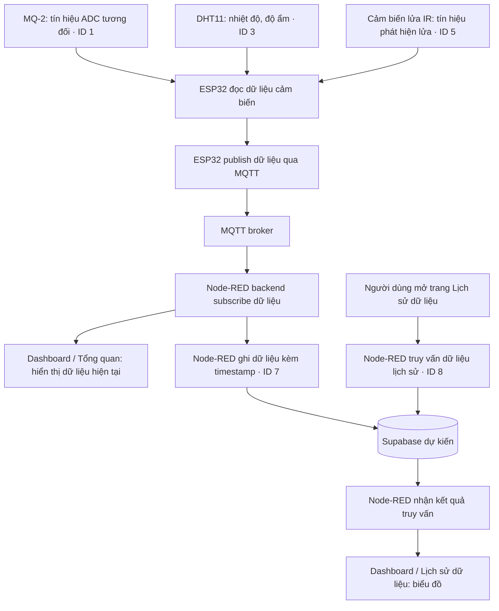
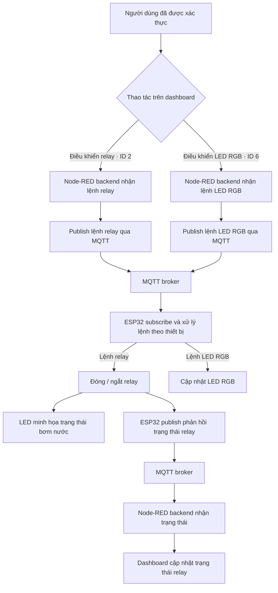
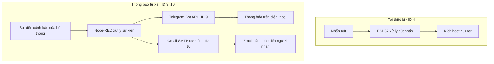
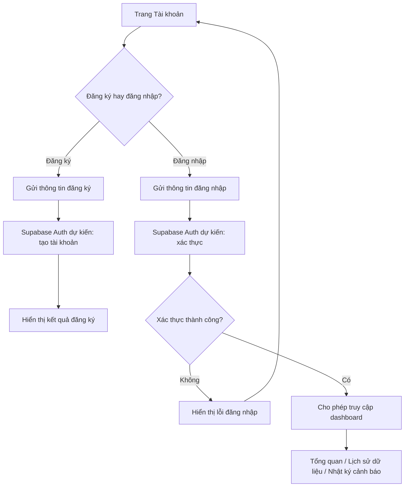
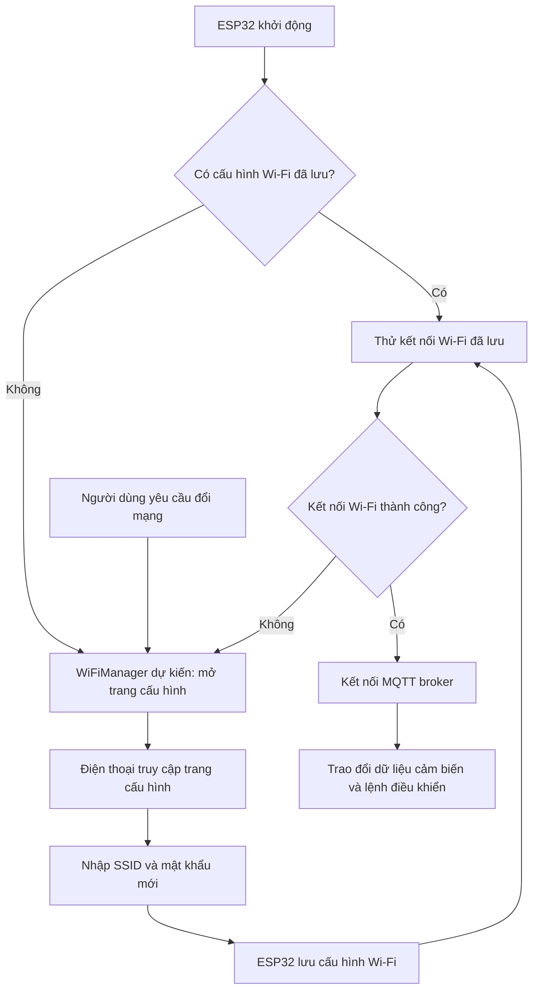

# Hệ thống cảnh báo cháy và phun nước minh họa

Đồ án IoT — Nhóm 12, Khoa Công nghệ Thông tin, Trường Đại học Khoa học Tự nhiên, Đại học Quốc gia Thành phố Hồ Chí Minh.

Mô hình phục vụ học tập, sử dụng ESP32 để thu thập dữ liệu cảm biến, phát cảnh báo tại chỗ và giao tiếp với website Node-RED qua MQTT. Người dùng có thể theo dõi tín hiệu bất thường trong một không gian nhỏ và gửi lệnh điều khiển từ dashboard. Khi mất Wi-Fi hoặc MQTT, cảnh báo cục bộ trên ESP32 vẫn hoạt động theo thiết kế đề xuất.

Phần phun nước được minh họa bằng relay điều khiển LED theo bảng chức năng trong proposal.

## Thành viên

| Thành viên | MSSV | Chức năng phụ trách |
|---|---|---|
| Lê Nhật Thành | 23120357 | MQ-2, Telegram Bot, xác thực tài khoản, cấu hình Wi-Fi |
| Nguyễn Văn Phước | 23120074 | DHT11, cảm biến lửa IR, LED RGB, email cảnh báo |
| Hà Công Thuận | 23120094 | Relay, nút nhấn và buzzer, lưu dữ liệu cloud, biểu đồ lịch sử |

## Chức năng

ID và phân công giữ nguyên theo proposal. Đây là phạm vi dự kiến, chưa phải danh sách tính năng đã hoàn thành.

| ID | Chức năng | Luồng xử lý | Phụ trách |
|---|---|---|---|
| 1 | Giám sát MQ-2 | MQ-2 → ESP32 → MQTT → Node-RED backend → dashboard; hiển thị tín hiệu ADC tương đối. | Thành |
| 2 | Điều khiển relay | Dashboard → Node-RED backend → MQTT → ESP32 → relay → LED; phản hồi trạng thái minh họa bơm nước. | Thuận |
| 3 | Giám sát nhiệt độ, độ ẩm | DHT11 → ESP32 → MQTT → Node-RED backend → dashboard. | Phước |
| 4 | Cảnh báo cục bộ | Nút nhấn → ESP32 → buzzer; không phụ thuộc MQTT. | Thuận |
| 5 | Giám sát tín hiệu lửa | Cảm biến lửa IR → ESP32 → MQTT → Node-RED backend → dashboard. | Phước |
| 6 | Điều khiển LED RGB | Dashboard → Node-RED backend → MQTT → ESP32 → LED RGB. | Phước |
| 7 | Lưu dữ liệu | Node-RED lưu dữ liệu cảm biến kèm timestamp lên Supabase dự kiến. | Thuận |
| 8 | Biểu đồ lịch sử | Node-RED đọc dữ liệu từ cloud và hiển thị biểu đồ. | Thuận |
| 9 | Thông báo Telegram | Sự kiện cảnh báo → Node-RED → Telegram Bot API → điện thoại. | Thành |
| 10 | Email cảnh báo | Sự kiện cảnh báo → Node-RED → email, dự kiến dùng Gmail SMTP. | Phước |
| 11 | Đăng ký, đăng nhập | Dự kiến dùng Supabase Auth để xác thực trước khi truy cập dashboard. | Thành |
| 12 | Cấu hình Wi-Fi | Dự kiến dùng WiFiManager trên ESP32 để nhập SSID và mật khẩu từ điện thoại khi mới lắp hoặc đổi mạng. | Thành |

## Sơ đồ luồng dữ liệu và xử lý

Các sơ đồ thể hiện luồng chức năng theo proposal. Proposal chưa quy định topic MQTT, cấu trúc payload, ngưỡng cảnh báo và cơ chế quản lý phiên; các chi tiết này cần khớp với mã nguồn khi hoàn thiện dự án.

### 1. Thu thập, hiển thị và lưu dữ liệu — ID 1, 3, 5, 7, 8

### 2. Điều khiển thiết bị từ website — ID 2, 6

### 3. Cảnh báo cục bộ và thông báo từ xa — ID 4, 9, 10

Luồng nút nhấn → ESP32 → buzzer không phụ thuộc Wi-Fi hoặc MQTT. Thông báo từ xa cần kết nối mạng và dịch vụ tương ứng. Proposal chưa mô tả điều kiện phát sinh sự kiện cảnh báo hoặc việc chuyển sự kiện nút nhấn lên Node-RED, nên sơ đồ giữ hai luồng riêng.

### 4. Đăng ký, đăng nhập và truy cập — ID 11

### 5. Cấu hình kết nối Wi-Fi — ID 12

Nhánh thử lại cấu hình Wi-Fi diễn giải quy trình thiết lập; thời gian chờ và cách yêu cầu đổi mạng cần xác định trong firmware. Luồng cảnh báo cục bộ hoạt động độc lập với quá trình kết nối mạng.

## Phần cứng và công nghệ

- **Bộ điều khiển:** một ESP32 NodeMCU LuaNode32, 38 chân.
- **Cảm biến:** MQ-2, DHT11, cảm biến lửa hồng ngoại MKE-S04.
- **Thiết bị điều khiển và cảnh báo:** relay một kênh 5 V, nút nhấn 12×12 mm, buzzer 5 V, LED đơn và LED RGB.
- **Nguồn và phụ kiện:** adapter 5 V 2 A, điện trở 220 Ω, dây, jack, domino và bảng hàn.
- **Giao tiếp và website:** MQTT, Node-RED backend và dashboard.
- **Dịch vụ tích hợp:** Telegram Bot; Supabase, Supabase Auth, Gmail SMTP và WiFiManager còn ở trạng thái dự kiến trong proposal.

## Tài liệu và mô hình

- [Proposal gốc của nhóm](docs/proposal/12_23120357_23120074_23120094_PROPOSAL.pdf): chức năng, thiết kế, dự toán và phân công.
- [Bản mô tả ý tưởng Markdown](ideas/IOT_PCCC_SYSTEM.MD).
- [Mô hình hộp 3D định dạng STEP](docs/models/IoT_PCCC.step), thiết kế trong Fusion.
