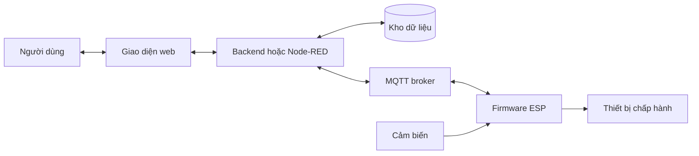
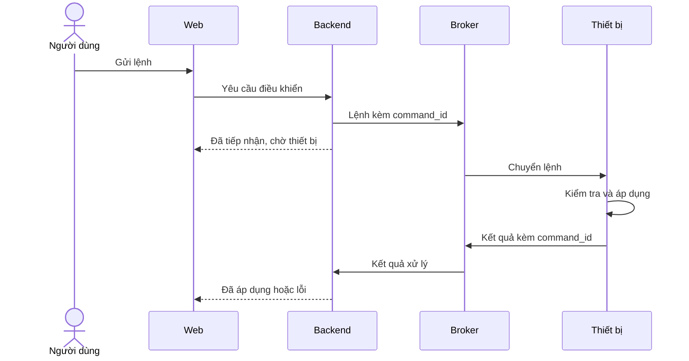

# Kiến trúc hệ thống — {{TEN_DU_AN}}

**Phiên bản:** {{PHIEN_BAN}}  
**Trạng thái:** {{NHAP_DANG_RA_SOAT_DA_CHOT}}  
**Người phụ trách:** {{HO_TEN}}  
**Cập nhật:** {{YYYY-MM-DD}}

> Điền kiến trúc thực tế và dẫn ID từ tài liệu yêu cầu. Các sơ đồ bên dưới là ví dụ, cần sửa hoặc bỏ thành phần không sử dụng. Xem [cách dùng bộ mẫu](README.md).

## 1. Đầu vào và mục tiêu thiết kế

- **Yêu cầu liên quan:** {{DUONG_DAN_TAI_LIEU_VA_CAC_ID}}
- **Quy mô:** {{SO_THIET_BI_NGUOI_DUNG_TAN_SUAT_DU_LIEU}}
- **Môi trường:** {{LOCAL_CLOUD_MANG_NOI_BO_GIA_LAP}}
- **Ràng buộc:** {{CHI_PHI_TAI_NGUYEN_THIET_BI_HA_TANG}}

## 2. Sơ đồ tổng thể

**Ví dụ minh họa:** mô hình có ESP, MQTT, backend và giao diện web.

**Ranh giới mạng và quyền truy cập:** {{THANH_PHAN_NAO_O_CUNG_MANG_CONG_NAO_DUOC_MO_AI_DUOC_TRUY_CAP}}.

## 3. Thành phần và trách nhiệm

| Thành phần | Trách nhiệm | Công nghệ / phiên bản | Chạy ở đâu | Yêu cầu liên quan | Người phụ trách |
|---|---|---|---|---|---|
| {{TEN}} | {{DAU_VAO_XU_LY_DAU_RA}} | {{CONG_NGHE_PHIEN_BAN}} | {{THIET_BI_HOAC_MAY_CHU}} | {{F_NF_ID}} | {{HO_TEN}} |

**Ranh giới xử lý:** {{VIEC_FIRMWARE_TU_QUYET_DINH_VIEC_BACKEND_XU_LY_VIEC_UI_CHI_HIEN_THI}}.

## 4. Luồng hoạt động chính

| Luồng | Bắt đầu | Các bước qua thành phần | Kết thúc / dữ liệu lưu | Cách phát hiện lỗi |
|---|---|---|---|---|
| Thu thập dữ liệu | {{CHU_KY_HOAC_SU_KIEN}} | {{CAM_BIEN_DEN_UI}} | {{KET_QUA}} | {{CACH_PHAT_HIEN}} |
| Điều khiển | {{THAO_TAC_HOAC_QUY_TAC}} | {{UI_DEN_THIET_BI_VA_PHAN_HOI}} | {{TRANG_THAI_XAC_NHAN}} | {{TIMEOUT_HOAC_LOI}} |
| Tự động hóa | {{DIEU_KIEN_KICH_HOAT}} | {{NOI_CHAY_LOGIC_VA_HANH_DONG}} | {{KET_QUA}} | {{CACH_PHAT_HIEN}} |

**Ví dụ minh họa:** tách phản hồi tiếp nhận lệnh khỏi xác nhận đã áp dụng.

**Quy tắc xác nhận thực tế:** {{TIN_HIEU_NAO_CHUNG_MINH_DA_AP_DUNG_CO_CAM_BIEN_PHAN_HOI_HAY_CHI_CO_TRANG_THAI_PHAN_MEM}}.

## 5. Trạng thái và khả năng phục hồi

| Tình huống | Cách nhận biết | Hành vi tại thiết bị / server / UI | Điều kiện trở lại bình thường | Yêu cầu liên quan |
|---|---|---|---|---|
| Mất Wi-Fi | {{TIN_HIEU_NGUONG}} | {{HANH_VI}} | {{DIEU_KIEN}} | {{NF_ID}} |
| Broker hoặc backend dừng | {{TIN_HIEU_NGUONG}} | {{HANH_VI}} | {{DIEU_KIEN}} | {{NF_ID}} |
| Dữ liệu cũ / cảm biến lỗi | {{TIN_HIEU_NGUONG}} | {{HANH_VI}} | {{DIEU_KIEN}} | {{NF_ID}} |
| Mất điện / reboot | {{CACH_NHAN_BIET}} | {{TRANG_THAI_DAU_RA_KHI_BOOT}} | {{DIEU_KIEN}} | {{NF_ID}} |
| Lệnh trùng / đến muộn | {{CACH_NHAN_DIEN}} | {{BO_QUA_XU_LY_HOAC_TU_CHOI}} | {{DIEU_KIEN}} | {{F_NF_ID}} |

**Xung đột chế độ:** {{UU_TIEN_GIUA_THU_CONG_TU_DONG_VA_NUT_VAT_LY_THOI_HAN_GHI_DE}}.

## 6. Quyết định kỹ thuật

| ID | Vấn đề | Phương án đã cân nhắc | Quyết định và lý do | Đánh đổi / điều kiện xem lại |
|---|---|---|---|---|
| ADR01 | {{VAN_DE}} | {{CAC_PHUONG_AN}} | {{LUA_CHON_VA_CO_SO}} | {{HAN_CHE_HOAC_MOC_XEM_LAI}} |

## 7. Triển khai và tài liệu liên quan

- **Sơ đồ môi trường và cách triển khai:** {{THAM_CHIEU_SETUP_VA_OPERATIONS}}
- **Chi tiết GPIO, nguồn:** {{THAM_CHIEU_HARDWARE}}
- **Topic, API, payload, schema:** {{THAM_CHIEU_INTERFACES}}
- **Điểm đo và test case xác minh thiết kế:** {{THAM_CHIEU_TESTING_CAC_TC_ID}}
- **Giới hạn hiện tại:** {{DIEM_NGHE_NUT_THAT_VA_HANG_MUC_CHUA_GIAI_QUYET}}
