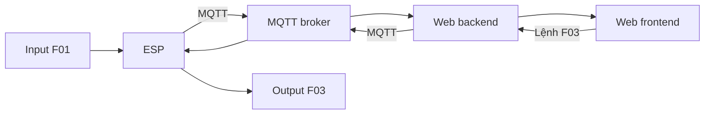

# ĐỀ XUẤT <SỐ-TT> — <TÊN TIẾNG ANH CỦA DỰ ÁN>

**Đề tài:** <Tên tiếng Việt>  
**Trường/Khoa/Lớp/Nhóm:** <Thông tin>  
**Thành viên:** A (<Họ tên, MSSV>), B (<Họ tên, MSSV>), C (<Họ tên, MSSV>)  
**Hình thức:** <Sản phẩm thật/Giả lập>  
**Thời gian dự kiến:** Tuần <...> đến tuần <...> (<3 hoặc 4 tuần>)

> Lưu file theo mẫu `SỐ-TT_TÊN_TIẾNG_ANH_CỦA_DỰ_ÁN.MD`, ví dụ `03_SMART_PARKING_SYSTEM.MD`. Khi hoàn tất, xuất PDF theo [Yêu cầu thuyết minh dự án](<../docs/CQ_YÊU CẦU THUYẾT MINH DỰ ÁN.pdf>) và đối chiếu [Quy định đồ án cuối kỳ](<../docs/CQ_QUY ĐỊNH ĐỒ ÁN CUỐI KỲ.pdf>). Thay toàn bộ nội dung trong `<...>` và xóa các dòng hướng dẫn trước khi nộp.

## 1. Giới thiệu

### 1.1. Tổng quan

<Vấn đề thực tế, đối tượng sử dụng, mục tiêu và phạm vi mô hình. Mô tả ngắn cách các ESP, website, MQTT và dịch vụ khác phối hợp; nêu giá trị của sản phẩm.>

### 1.2. Danh sách chức năng

<Liệt kê một luồng căn bản riêng cho từng thành viên. Chọn yêu cầu nâng cao từ đúng mục C.2 của PDF quy định; ghi đúng số mục, điểm và người chịu trách nhiệm chính. Không mặc định đề tài nào cũng phải có đủ 12 chức năng.>

| ID | Loại và mục quy định | Thiết bị/dịch vụ | Luồng xử lý, kết quả nhìn thấy | Người phụ trách chính |
|---|---|---|---|---|
| F01 | Căn bản: input → web | <Input riêng 1> | Input → ESP → MQTT → backend → frontend → <dữ liệu hiển thị> | A |
| F02 | Căn bản: input → web | <Input riêng 2> | Input → ESP → MQTT → backend → frontend → <dữ liệu hiển thị> | B |
| F03 | Căn bản: web → output | <Output riêng 1> | Frontend → backend → MQTT → ESP → output → <tác động thực tế> | C |
| F04 | Nâng cao #<mục>: <tên>, <điểm> | <Thiết bị/dịch vụ riêng> | <Luồng và tiêu chí kiểm chứng> | <A/B/C> |
| F05 | Nâng cao #<mục>: <tên>, <điểm> | <Thiết bị/dịch vụ riêng> | <Luồng và tiêu chí kiểm chứng> | <A/B/C> |
| F... | <Thêm/xóa hàng theo đề tài> | <...> | <...> | <...> |

**Kiểm tra thiết bị:** Liệt kê từng thiết bị input/output vật lý theo ID: <F01: ...; F02: ...; F03: ...; F04: ...>. Mọi thiết bị dùng trong các yêu cầu khác nhau, kể cả **cả hai thiết bị** của luồng input → output nâng cao, phải **đôi một khác nhau**. Ghi rõ thiết bị nào chỉ là board trung gian, relay/driver hoặc dịch vụ, và giải thích trường hợp có thể bị hiểu là tái sử dụng thiết bị/dữ liệu. Mỗi yêu cầu nâng cao chỉ giao **một** sinh viên/nhóm. Nếu giả lập, ghi thiết bị thay thế và kiểm tra giới hạn tối đa **một** thiết bị thay thế không có trong giả lập; thiết bị ấy cũng phải khác các thiết bị còn lại.

## 2. Thiết kế

### 2.1. Bố trí bên ngoài và bên trong

<Vị trí cảm biến, thiết bị chấp hành, ESP, nguồn, hộp, đầu nối, đường dây và vật liệu mô hình. Nêu khoảng cách, hướng đặt, chống nước/cách điện hoặc giới hạn vận hành nếu liên quan. Gắn ID chức năng với từng linh kiện.>

```text
Mặt ngoài: [<thiết bị + ID>] [<thiết bị + ID>]
Bên trong: [<ESP>] [<nguồn>] [<driver/relay>] [<đầu nối>]
Đường tín hiệu/nguồn/tải: <mô tả ngắn>
```

<Chèn hoặc dẫn tới hình 3D/bản vẽ hai góc nhìn ngoài và trong, đánh dấu linh kiện theo yêu cầu PDF.>

### 2.2. Wireframe website

```text
┌───────────────────────────────────────────────┐
│ <Tên website, đăng nhập/trạng thái kết nối>   │
├───────────────────────────────────────────────┤
│ <Số đo/trạng thái F...> │ <Lệnh điều khiển F...>│
│ <Biểu đồ/lịch sử nếu đăng ký yêu cầu tương ứng>│
└───────────────────────────────────────────────┘
```

<Nêu người dùng thao tác gì, quyền truy cập, phản hồi khi lỗi/mất kết nối. Chỉ giữ các phần thực sự có trong bảng chức năng.>

### 2.3. Sơ đồ truyền và nhận dữ liệu



<Bổ sung mọi luồng nâng cao thực sự chọn: ESP-NOW/BLE, cloud, thông báo, v.v. Ghi topic MQTT, payload, chiều truyền và cách xử lý khi mất mạng. Nếu dùng đồng thời WiFi và ESP-NOW, kiểm thử kênh WiFi theo [tài liệu Espressif](https://docs.espressif.com/projects/arduino-esp32/en/latest/api/espnow.html).>

### 2.4. Dự án tương tự và phần có thể tham khảo

| Nguồn trực tiếp | Phần hữu ích cho đề xuất | Điều chỉnh để đúng yêu cầu đề tài |
|---|---|---|
| [<Tên dự án/mã nguồn>](<URL>) | <Mạch, mã, bố trí hoặc giao diện cụ thể> | <Điểm cần sửa hoặc kiểm chứng> |
| [<Tên dự án/mã nguồn>](<URL>) | <...> | <...> |

<Tách phần đã được nguồn chứng minh khỏi phần nhóm tự thiết kế. Không coi sơ đồ hoặc mã của dự án khác là bằng chứng hệ thống của nhóm đã hoạt động.>

## 3. Triển khai

### 3.1. Danh sách linh kiện và dự toán

**Ngày tra giá:** <dd/mm/yyyy>. **Đơn vị:** VND. Giá chỉ là tham khảo; kiểm tra đúng biến thể, điện áp/dòng, phí vận chuyển và tình trạng còn hàng trước khi mua. Với linh kiện khó tìm, có thể dùng nguồn thương mại điện tử và ghi rõ người bán/biến thể.

| STT | Linh kiện/vật tư | SL | Đơn giá | Thành tiền | Nguồn giá và ghi chú | ID |
|---|---|---:|---:|---:|---|---|
| 1 | <ESP/board, model cụ thể> | <...> | <...> | <...> | [<Nhà cung cấp>](<URL>) | <F...> |
| 2 | <Cảm biến, model cụ thể> | <...> | <...> | <...> | [<Nhà cung cấp>](<URL>) | <F...> |
| 3 | <Thiết bị output, model cụ thể> | <...> | <...> | <...> | [<Nhà cung cấp>](<URL>) | <F...> |
| 4 | <Nguồn, dây, hộp, vật tư mô hình> | <...> | <...> | <...> | <Nguồn hoặc ghi ước tính> | <F...> |
| | **Tổng tham khảo** | | | **<Tổng>** | <Khoản chưa tính> | |

<Kiểm tra tổng = tổng các thành tiền; nguồn cấp và driver phù hợp với tải. Ghi riêng chi phí dịch vụ nếu có.>

### 3.2. Kế hoạch thực hiện

**Tuần 1–<3 hoặc 4> tính từ <ngày/tuần bắt đầu>.** Đặt linh kiện sớm; mỗi tuần phải có đầu ra kiểm chứng được. Chỉ chọn 4 tuần khi khối lượng tích hợp khó hoàn thành trong 3 tuần.

| Tuần | ID chức năng | Công việc và đầu ra kiểm chứng | Người phụ trách chính |
|---|---|---|---|
| 1 | <F...> | <Chốt sơ đồ, đặt linh kiện, chạy thử từng thiết bị và hợp đồng MQTT> | <A/B/C> |
| 2 | <F...> | <Hoàn thiện các luồng căn bản trên ESP, backend, frontend> | <A/B/C> |
| 3 | <F...> | <Yêu cầu nâng cao, tích hợp, thử lỗi/mất mạng, hình 3D, báo cáo> | <A/B/C> |
| 4 (nếu cần) | <F...> | <Kiểm thử và sửa lỗi còn lại, hoàn thiện mô hình/PDF> | <A/B/C> |

## 4. Tổng kết và phân chia công việc

Theo mục **C.1 — Yêu cầu căn bản** của [Quy định đồ án cuối kỳ](<../docs/CQ_QUY ĐỊNH ĐỒ ÁN CUỐI KỲ.pdf>), mỗi sinh viên thực hiện một luồng input → ESP → MQTT → web backend → web frontend **hoặc** web frontend → web backend → MQTT → ESP → output; các thiết bị của những yêu cầu khác nhau phải đôi một khác nhau. Điểm dự kiến cho mỗi người khi đạt đủ điều kiện: **4,0 điểm chức năng căn bản + 1,0 điểm làm việc nhóm** (mã được tích hợp trong một project).

Theo mục **C.2 — Yêu cầu nâng cao**, chọn các mục và điểm chính xác từ PDF, mỗi mục chỉ giao **một** người/nhóm; tổng điểm nâng cao dự kiến **không quá 4,0 điểm/người**. <Ghi phép cộng theo ID: A = ...; B = ...; C = ...>. Điểm phụ thuộc sản phẩm và vấn đáp. Điểm báo cáo cuối kỳ và điểm cộng xét cho sản phẩm thật, nếu có, ghi riêng theo quy định; không cộng lẫn vào bảng này.

| Thành viên | ID phụ trách và sản phẩm bàn giao | Điểm căn bản (gồm nhóm) | Điểm nâng cao dự kiến | Tổng tạm tính, chưa gồm báo cáo |
|---|---|---:|---:|---:|
| A | <F..., phần cứng/mã/tài liệu> | <...> | <...> | <...> |
| B | <F..., phần cứng/mã/tài liệu> | <...> | <...> | <...> |
| C | <F..., phần cứng/mã/tài liệu> | <...> | <...> | <...> |

**Rà soát cuối:** <Mỗi người có luồng căn bản; từng yêu cầu nâng cao có một chủ sở hữu; mọi thiết bị input/output đôi một khác nhau; điểm đúng mục C.2; sơ đồ, BOM, lịch và bảng phân công khớp ID; nguồn tham khảo truy cập được; hình minh họa rõ; PDF đúng định dạng.>
