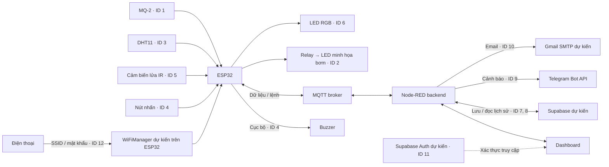

# ĐỀ XUẤT 01 — HỆ THỐNG CẢNH BÁO CHÁY VÀ PHUN NƯỚC MINH HỌA

**Đề tài:** Hệ thống cảnh báo cháy và phun nước minh họa.  
**Trường:** Trường Đại học Khoa học Tự nhiên, Đại học Quốc gia Thành phố Hồ Chí Minh.  
**Khoa:** Công nghệ Thông tin.  
**Mã nhóm:** 12.  
**Thành viên:** Lê Nhật Thành — 23120357; Nguyễn Văn Phước — 23120074; Hà Công Thuận — 23120094.

Nội dung chuyển từ [proposal của nhóm](../docs/proposal/12_23120357_23120074_23120094_PROPOSAL.pdf), theo cấu trúc của bản ý tưởng Smart Home Security System trước đây. Đây là kế hoạch triển khai, chưa phải kết quả hoàn thành. Các dịch vụ ghi “dự kiến” giữ nguyên trạng thái trong proposal.

## 1. Giới thiệu

### 1.1. Tổng quan

Mô hình phục vụ học tập, gồm một ESP32, cảm biến MQ-2, DHT11, cảm biến lửa IR, cảnh báo tại chỗ, phần chấp hành minh họa và website Node-RED. Dữ liệu đo truyền qua MQTT đến backend rồi dashboard; lệnh điều khiển đi theo chiều ngược lại.

Hệ thống giúp nhận biết sớm tín hiệu bất thường trong một không gian nhỏ và theo dõi từ xa. Khi mất Wi-Fi hoặc MQTT, cảnh báo cục bộ trên ESP32 vẫn hoạt động. MQ-2 hiển thị tín hiệu ADC tương đối. Trong bảng chức năng của proposal, relay điều khiển LED tượng trưng cho việc bơm nước; danh sách linh kiện chưa có bơm nước thật.

### 1.2. Danh sách chức năng

ID và phân công giữ nguyên từ proposal.

| ID | Loại | Thiết bị/dịch vụ | Luồng xử lý dự kiến | Phụ trách |
|---|---|---|---|---|
| 1 | Căn bản: input → web | MQ-2 | MQ-2 → ESP32 → MQTT → Node-RED backend → dashboard; hiển thị ADC tương đối. | Thành |
| 2 | Căn bản: web → output | Relay → LED | Dashboard → Node-RED backend → MQTT → ESP32 → relay → LED; phản hồi trạng thái tượng trưng cho bơm nước. | Thuận |
| 3 | Căn bản: input → web | DHT11 | DHT11 → ESP32 → MQTT → Node-RED backend → dashboard; hiển thị nhiệt độ, độ ẩm. | Phước |
| 4 | Nâng cao #1 | Nút nhấn + buzzer | Nút nhấn → ESP32 → buzzer; cảnh báo cục bộ không phụ thuộc MQTT. | Thuận |
| 5 | Nâng cao #2 | Cảm biến lửa IR | IR → ESP32 → MQTT → Node-RED backend → dashboard. | Phước |
| 6 | Nâng cao #3 | LED RGB | Dashboard → Node-RED backend → MQTT → ESP32 → LED RGB. | Phước |
| 7 | Nâng cao #4 | Supabase dự kiến | Node-RED lưu dữ liệu cảm biến kèm timestamp lên cloud. | Thuận |
| 8 | Nâng cao #5 | Supabase dự kiến | Node-RED đọc lịch sử từ cloud và hiển thị biểu đồ. | Thuận |
| 9 | Nâng cao #6 | Telegram Bot | Sự kiện cảnh báo → Node-RED → Telegram Bot API → thông báo trên điện thoại. | Thành |
| 10 | Nâng cao #7 | Gmail SMTP dự kiến | Sự kiện cảnh báo → Node-RED → email. | Phước |
| 11 | Nâng cao #9 | Supabase Auth dự kiến | Đăng ký → cơ sở dữ liệu; đăng nhập → xác thực trước khi truy cập dashboard. | Thành |
| 12 | Nâng cao #12 | WiFiManager dự kiến | ESP32 mở trang cấu hình khi mới lắp hoặc đổi mạng; điện thoại nhập SSID và mật khẩu mới. | Thành |

## 2. Thiết kế

### 2.1. Bố trí bên ngoài và bên trong

Nhóm thiết kế mẫu hộp 3D trong Fusion. Hình sản phẩm nằm ở trang 3 của proposal; mô hình CAD lưu tại [IoT_PCCC.step](../docs/models/IoT_PCCC.step). Dùng hình và file CAD làm tham chiếu bố trí khi lắp ESP32, cảm biến, nút nhấn, buzzer và LED.

### 2.2. Wireframe website

Proposal có bốn wireframe ở trang 4–5. Bảng sau tóm tắt vai trò các trang theo danh sách chức năng; chi tiết hình giao diện giữ trong proposal gốc.

| Trang | Chức năng liên quan |
|---|---|
| Tổng quan | Theo dõi MQ-2, DHT11, cảm biến lửa; điều khiển relay và LED RGB. |
| Lịch sử dữ liệu | Xem dữ liệu đã lưu và biểu đồ từ cloud. |
| Nhật ký cảnh báo | Theo dõi sự kiện cảnh báo. |
| Tài khoản | Đăng ký, đăng nhập và xác thực truy cập dashboard. |

### 2.3. Sơ đồ truyền và nhận dữ liệu

Sơ đồ dưới đây diễn giải các luồng trong bảng chức năng; sơ đồ hình gốc ở trang 6 của proposal.

Luồng nút nhấn → ESP32 → buzzer chạy tại thiết bị, không đi qua MQTT. Theo dõi và điều khiển từ dashboard đi qua Node-RED backend và MQTT.

## 3. Triển khai

### 3.1. Danh sách linh kiện và dự toán

Số lượng và giá chép từ proposal, chưa cập nhật theo giá mua hiện tại. STT được đánh lại liên tục; ID chức năng giữ nguyên.

| STT | Linh kiện | SL | Chi phí trong proposal (VND) | ID / vai trò |
|---|---|---:|---:|---|
| 1 | ESP32 NodeMCU LuaNode32, Wi-Fi, 38 chân | 1 | 149.100 | 1–6, 12 |
| 2 | Cảm biến MQ-2 | 1 | 31.920 | 1 |
| 3 | DHT11 mạch cảm biến | 1 | 19.380 | 3 |
| 4 | MKE-S04 cảm biến lửa IR | 1 | 30.000 | 5 |
| 5 | Module relay 1 kênh 5 V | 1 | 19.380 | 2 |
| 6 | Adapter 5 V 2 A | 1 | 31.920 | Nguồn |
| 7 | Nút nhấn 12×12 mm | 1 | 2.052 | 4 |
| 8 | Buzzer 5 V | 1 | 4.560 | 4 |
| 9 | LED 5 mm: LED đơn và LED RGB | 2 | 285–798 / con | 6, cảnh báo phụ |
| 10 | Điện trở 220 Ω | 50 | 3.200 cho 50 con (64 / con) | 1, 3, 6 |
| 11 | Dây, jack, domino, bảng hàn | Không nêu | Có sẵn | Toàn hệ thống |
| 12 | Các linh kiện khác | Không nêu | 100.000 dự phòng | Toàn hệ thống |

Proposal lấy giá cảm biến lửa từ Hshop, các linh kiện có liên kết còn lại từ Thế Giới IC. Liên kết chi tiết và ảnh ở trang 7–9 của PDF. Proposal chưa ghi tổng chi phí; bảng này giữ từng khoản gốc.

### 3.2. Kế hoạch thực hiện

Thời lượng dự kiến cho từng chức năng, chưa phải lịch theo ngày hoặc tổng thời gian toàn dự án.

| ID | Chức năng | Thời gian dự kiến | Phụ trách |
|---|---|---|---|
| 1 | MQ-2 | 3 ngày | Thành |
| 2 | Relay | 3 ngày | Thuận |
| 3 | DHT11 | 2 ngày | Phước |
| 4 | Nút nhấn + buzzer | 2 ngày | Thuận |
| 5 | Cảm biến lửa IR | 2 ngày | Phước |
| 6 | LED RGB | 2 ngày | Phước |
| 7 | Lưu cloud bằng Supabase dự kiến | 3 ngày | Thuận |
| 8 | Biểu đồ từ Supabase dự kiến | 2 ngày | Thuận |
| 9 | Telegram Bot | 2 ngày | Thành |
| 10 | Gmail SMTP dự kiến | 2 ngày | Phước |
| 11 | Supabase Auth dự kiến | 4 ngày | Thành |
| 12 | WiFiManager dự kiến | 3 ngày | Thành |

## 4. Tổng kết và phân chia công việc

| Thành viên | MSSV | ID phụ trách | Điểm cơ bản trong proposal | Điểm nâng cao trong proposal | Tổng trong proposal |
|---|---|---|---:|---|---:|
| Lê Nhật Thành | 23120357 | 1, 9, 11, 12 | 4 | 4,5/4 | 8 |
| Nguyễn Văn Phước | 23120074 | 3, 5, 6, 10 | 4 | 4/4 | 8 |
| Hà Công Thuận | 23120094 | 2, 4, 7, 8 | 4 | 4,5/4 | 8 |

Các cột điểm chép nguyên từ proposal, là mức dự kiến của nhóm, chưa phải kết quả chấm. Cả ba thành viên tích hợp chức năng vào cùng mô hình ESP32, MQTT và Node-RED.
